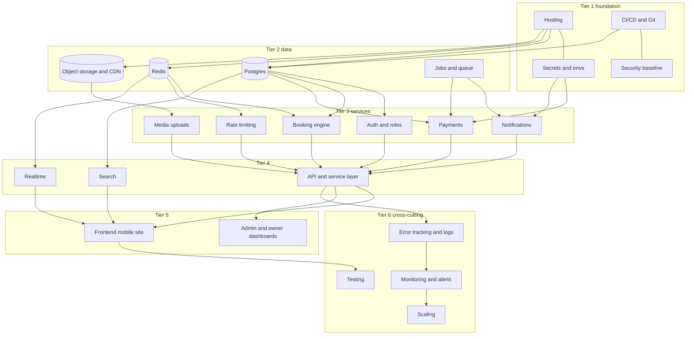
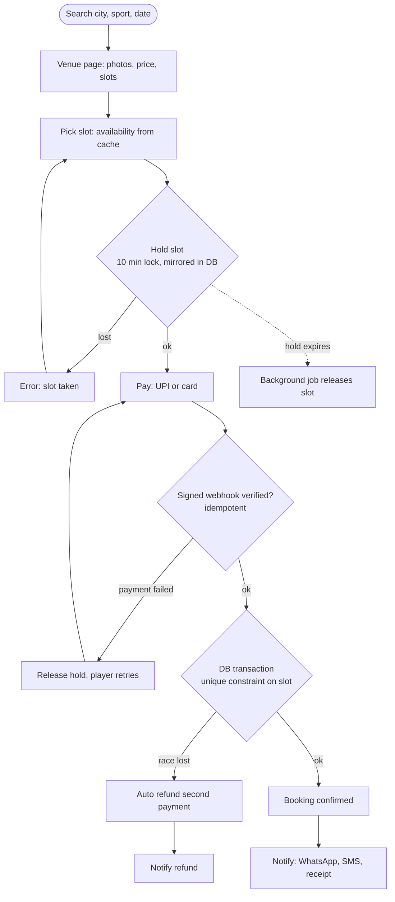
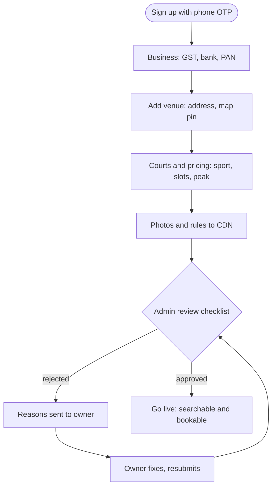
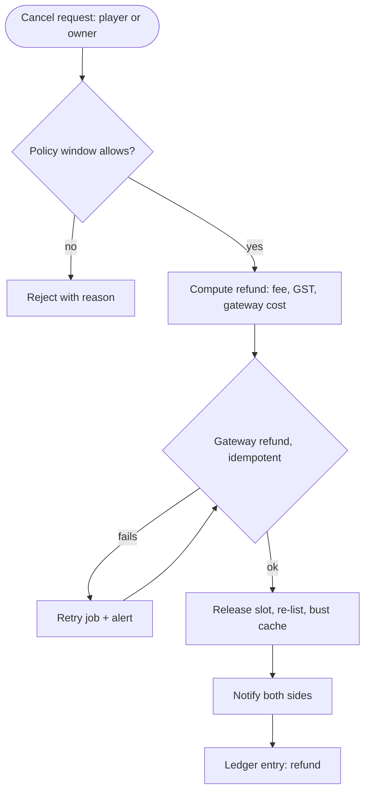
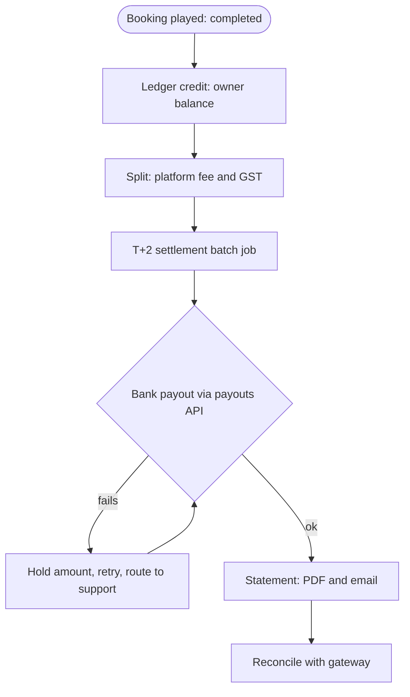
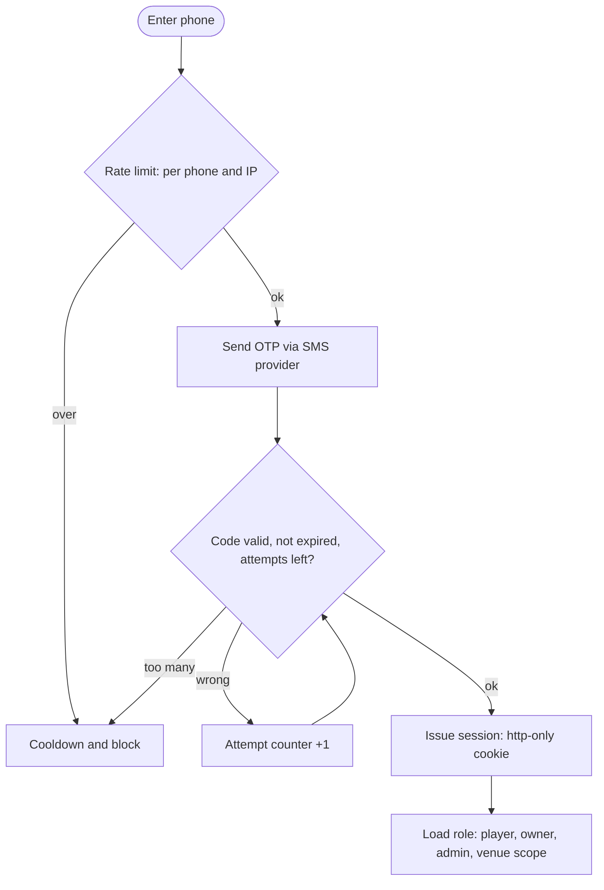
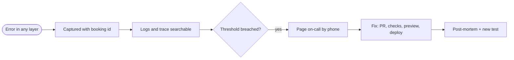
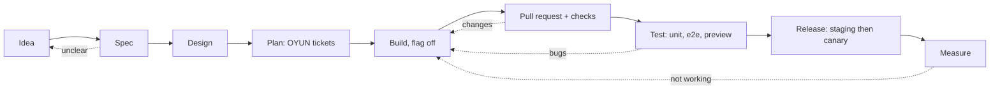
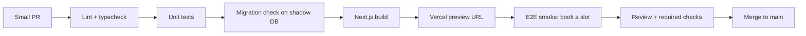
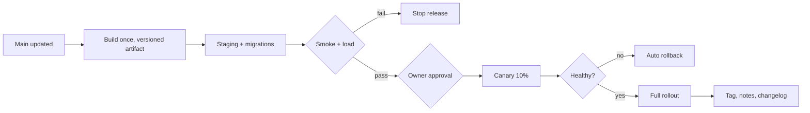

# OYUN brief plan: workflows, work and tasks

Turns the build brief (tiers, workflows 4.1 to 4.7, pipelines 5.1 and 5.2) into diagrams, work packages and tickets. Checked against the repo on 14 Oct 2026. Companion to `docs/FLOWCHARTS.md` (rules already in code), `docs/TASK-WORKFLOW.md` (queue) and `docs/build-tracker.html` (status). Deadline: 31 Oct 2026.

Status key: DONE in repo, PART partly built, GAP not built, GATE needs a user decision first.

## 0. Brief versus repo: decisions needed

The brief assumes a stack the repo does not use. Pick one per row before Tier 2 and 3 start; each changes the ticket list.

| Brief says | Repo has | Needed |
|---|---|---|
| Phone OTP auth, roles scoped to a venue | Clerk for players, own email and password for partners and admin | Keep Clerk (phone OTP is a Clerk setting) or build OTP. Recommend keep Clerk. |
| Redis for holds, cache, rate limits | Holds in jsonb store and Postgres, rate limits in Postgres (`shared-rate-limit.ts`) | Add Redis now, or keep Postgres until a number says so (principle in section 1). Recommend keep. |
| Typed API, one service layer | Server actions in `src/modules/*/backend/*-actions.ts`, one `store.ts` | Server actions count as the service layer. Confirm. |
| Gateway, webhooks, refunds, ledger | None (no payment code) | GATE: Razorpay account and test keys. |
| WhatsApp, SMS, email, push | None | GATE: provider choice. |
| Queue and background jobs | None; holds purged inline | Vercel Cron or pg_cron. GATE: production approval. |
| Sentry, paging by phone call | JSON log plus `ERROR_WEBHOOK_URL` (`monitoring.ts`) | GATE: uptime and paging service. |
| Canary 10%, auto rollback | Vercel deploys from main | Vercel rolling release (check plan). |

## 1. Build order (section 3 as a diagram)

## 2. Workflows

Every step idempotent and logged with the booking id. Failure branches are red-path tickets, not extras.

### 2.1 Player books a slot

### 2.2 Venue owner onboarding

### 2.3 Cancel and refund

### 2.4 Payout and settlement

### 2.5 OTP login and session

### 2.6 Failure to fix

### 2.7 Idea to production (every feature)

Definition of done on every ticket: docs and runbook, feature flag and rollback plan, analytics event, errors tracked with booking id, rate limit and auth checked.

## 3. Pipelines

### 3.1 Pull request (5.1)

Repo today (`.github/workflows/ci.yml`): lint, typecheck, unit, build; SQL migrations and tests on Postgres 17; Playwright e2e desktop and mobile. Gaps: required-check branch rule, e2e must include hold-to-confirm path once payments land.

### 3.2 Release (5.2)

Repo today: Vercel deploy from main, no staging, no canary, no load check, no tags.

## 4. Work packages and tickets

Ticket ids `B-<tier>.<n>`. "Maps to" links existing tracker ids so nothing is duplicated. Dates are the target finish.

### Tier 1: foundation (14 to 16 Oct)

| Id | Task | Status | Maps to |
|---|---|---|---|
| B-1.1 | Staging env on Vercel and Supabase branch | GATE | P8-12 |
| B-1.2 | Secrets inventory: dev, staging, prod; rotation steps; none in repo | PART | P9-01, R006 |
| B-1.3 | Required checks on main (branch protection) | GAP | |
| B-1.4 | Security baseline: CSP nonces, admin MFA | PART | P9-13, P9-09 |
| B-1.5 | Gitleaks step in CI | GAP | |

### Tier 2: data (16 to 20 Oct)

| Id | Task | Status | Maps to |
|---|---|---|---|
| B-2.1 | Slot booking v2 migration with unique/exclusion constraint | PART (proposal tested) | D section |
| B-2.2 | Cut bookings, holds, blocks off jsonb | GAP | R008 |
| B-2.3 | Redis decision; if yes, hold lock and availability cache | GATE | |
| B-2.4 | Object storage and CDN for photos, resize, scan | GATE | P10-09 |
| B-2.5 | Jobs: hold expiry, refund retry, settlement, reports | GAP | P10-06 |

### Tier 3: services (20 to 25 Oct)

| Id | Task | Status | Maps to |
|---|---|---|---|
| B-3.1 | Auth: phone OTP via Clerk, venue-scoped roles, bind wallet to account | PART | P9-03 |
| B-3.2 | Booking engine: one winner per slot test in CI, race-lost auto refund hook | PART | P8-04 |
| B-3.3 | Payments: order, signature, idempotent webhook | GATE | P11-01, P11-02 |
| B-3.4 | Refunds per policy, wallet ledger, owner ledger | GATE | P11-04, R013 |
| B-3.5 | Payouts: split, T+2 batch, statement, reconcile | GATE | P11-05 |
| B-3.6 | Notifications: confirm, reminder, owner alert, receipt | GATE | P12-01 to 04 |
| B-3.7 | Rate limits on OTP, search, holds | PART | R011, P9-06 |
| B-3.8 | Media uploads with host allowlist and scan | PART | P9-12 |

### Tier 4: API, realtime, search (24 to 27 Oct)

| Id | Task | Status | Maps to |
|---|---|---|---|
| B-4.1 | Audit: every rule in service layer, none in UI | PART | |
| B-4.2 | Realtime slot status, drop 10 s poll | PART | P10-04 |
| B-4.3 | Search: city, sport, date filters, map, ranking | PART | P13-04 |
| B-4.4 | SEO pages per city, area, sport | GAP | LAUNCH-SEO |

### Tier 5: frontend and dashboards (25 to 29 Oct)

| Id | Task | Status | Maps to |
|---|---|---|---|
| B-5.1 | Mobile flow: hold timer, pay, retry, confirm screens | PART | |
| B-5.2 | Owner onboarding steps 2.2 with rejection and resubmit | PART | |
| B-5.3 | Owner dashboard: bookings, payouts, statements | GAP | |
| B-5.4 | Admin: review checklist, refunds, support queue | PART | |
| B-5.5 | Support and disputes, no-shows | PART | |

### Tier 6: cross-cutting (27 to 31 Oct)

| Id | Task | Status | Maps to |
|---|---|---|---|
| B-6.1 | One e2e per workflow 2.1 to 2.5 incl. failure branches | PART | P8-07 |
| B-6.2 | k6 load test of booking path | GAP | P10-08 |
| B-6.3 | Error tracking with booking id on every log line | PART | |
| B-6.4 | Alerts and on-call paging; double bookings must be 0 | GATE | |
| B-6.5 | Release pipeline 3.2: artifact, staging, canary, rollback, tag | GAP | |
| B-6.6 | Backups and restore drill | GAP | |
| B-6.7 | DPDP export and delete, GST invoice fields, terms | GAP | |
| B-6.8 | Runbooks: payout failed, refund failed, webhook down, double booking | GAP | |

## 5. Timeline risk

17 days left. B-3.3 to B-3.6 and B-6.4 cannot start without your decisions on gateway, messaging and paging. Each day without them removes a day from the 31 Oct finish. Everything else can proceed in parallel.

## 6. New tracker ids

Gaps with no existing task were added to `docs/build-tracker.html` on 14 Oct 2026:

| Brief | Tracker |
|---|---|
| B-1.3 | P8-57 |
| B-1.5 | P8-58 |
| B-6.5 | P8-59 |
| B-6.1 | P8-60 |
| B-6.4 | P8-61 |
| B-6.8 | P8-62 |
| B-6.7 | P8-63 |
| B-2.3 | P10-17 |
| B-3.5 (bank payouts) | P11-08 |
| B-3.2 (race-lost refund) | P11-09 |

Everything else maps to an existing id in the tables above.
