# OYUN codebase map

A visual guide to how OYUN works: the pages, who uses them, how a booking flows through the code, where data lives and how changes ship. Diagrams are Mermaid, so GitHub renders them. Text docs that go deeper: `docs/ARCHITECTURE.md` (rules and limits), `docs/adr/` (why), `docs/SECURITY.md`, `docs/ENVIRONMENTS.md`, `docs/SLOT-BOOKING-DB.md` (target database).

OYUN is a multi-sport turf and court booking site for Mangalore (football, box cricket, badminton, pickleball). One Next.js 16 app serves the website and the backend; there is no separate API server or mobile app.

## 1. The system at a glance

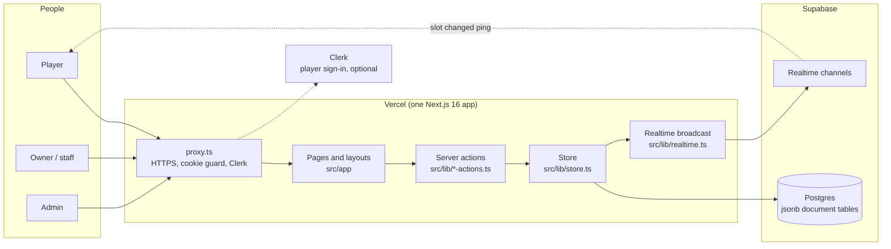

Key points:

- The browser never talks to the database. Everything goes through server actions that use the service-role key.
- Clerk is optional. Without keys, players use a device name-and-phone fallback.
- Admin and partner use signed cookie sessions (not Clerk).

## 2. Site map: every page and who it is for

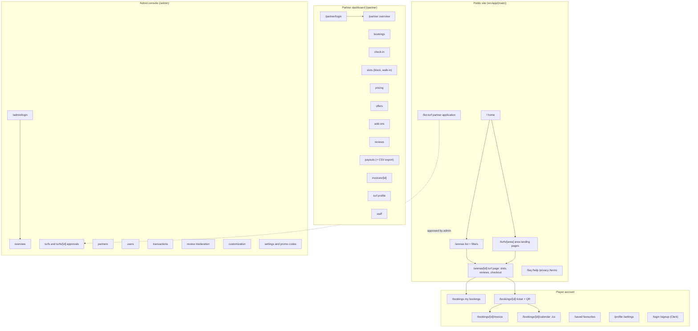

API routes (not pages): `/api/health` (launch checks and storage mode), `/api/holds/release` (release holds when a tab closes), `/api/client-error` (browser errors to the error webhook).

## 3. Who can do what

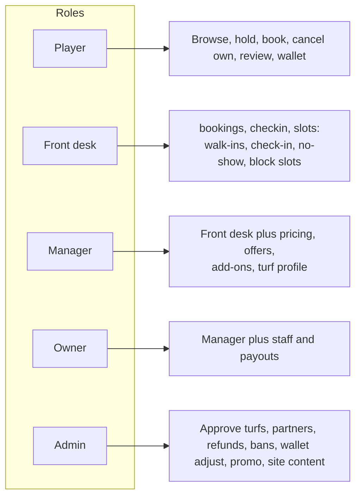

Rule in code: every admin action calls `requireAdmin()` and every partner action calls `requirePartnerAction(permission)` before touching data. `src/lib/authorization.test.ts` fails if an action lacks its guard. Permission sets (`PERMISSIONS` in `src/lib/partner-auth.ts`): front desk = bookings, checkin, slots; manager adds pricing, offers, addons, turf; owner adds staff and payouts.

## 4. How a booking works (end to end)

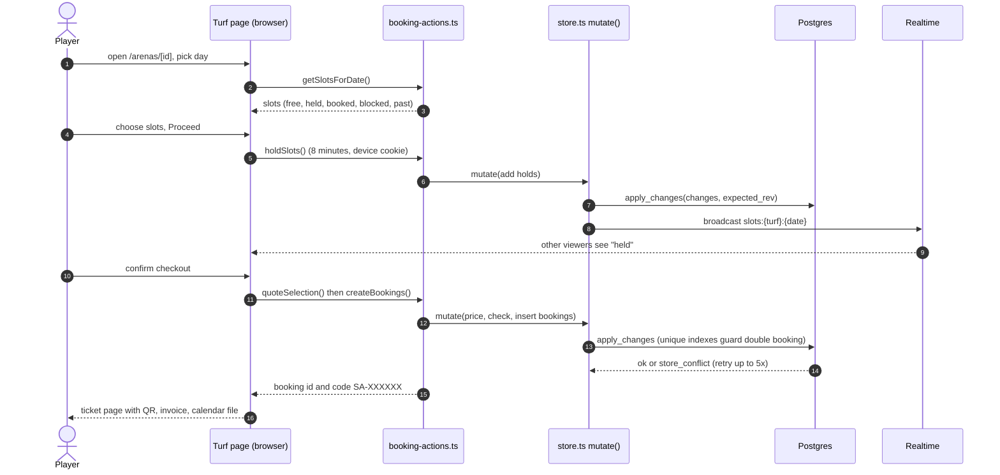

Why it cannot double book: `apply_changes` only writes if the global revision still equals what the server loaded (otherwise `store_conflict` and retry), and partial unique indexes on bookings, blocks and holds reject a second live row for the same turf, date and hour. `scripts/sql-race-test.sh` proves this in CI.

### Booking states

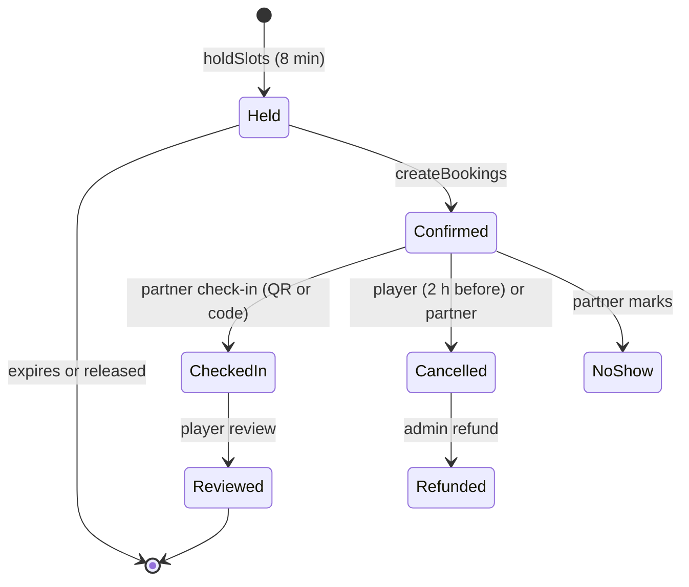

Only `confirmed` and `checked_in` occupy a slot. A multi-hour booking is one booking row per hour. The advance is recorded, not charged online; the rest is paid at the turf.

## 5. Inside a write: the store

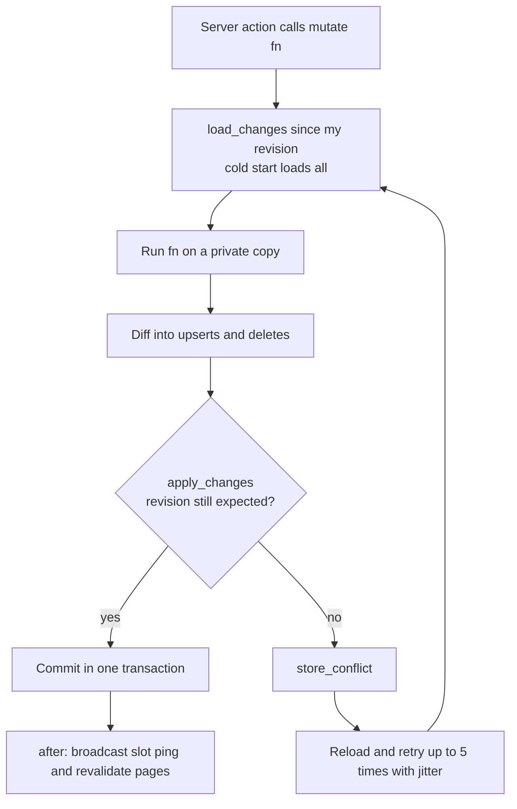

## 6. Data model

All data lives in 14 jsonb document tables (`id`, `seq`, `data`, `updated_at`) in `supabase/setup/1-tables.sql`, plus `app_meta` for the revision counter. TypeScript shapes are in `src/lib/types.ts`.

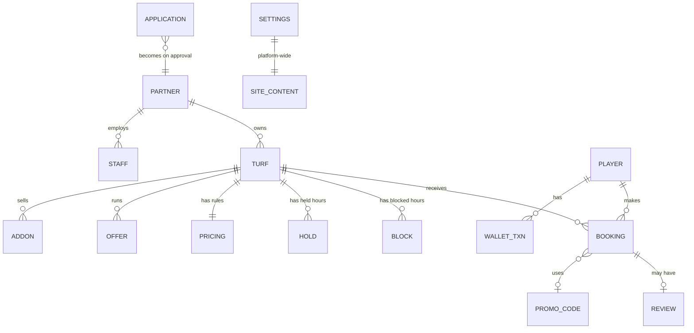

Not exact foreign keys: relationships live inside the JSON and are enforced by code, apart from the unique indexes and the CHECK constraints in `supabase/setup/7-check-constraints.sql`.

## 7. Source tree

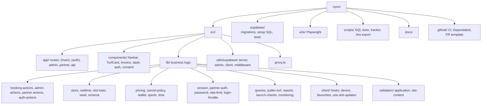

| Area | What lives there |
| --- | --- |
| `src/app/(main)` | Public and player pages |
| `src/app/partner`, `src/app/admin` | Dashboards; each has a `/login` and a `(dashboard)` group guarded in its layout |
| `src/lib/*-actions.ts` | Server actions: the only write path |
| `src/lib/store.ts` | `getDb()` read, `mutate(fn)` write, revision lock, delta sync |
| `src/lib/pricing.ts` | One function prices both the quote and the charge |
| `src/lib/session.ts`, `partner-auth.ts` | Signed cookie sessions, roles, permissions |
| `src/lib/public-turf.ts` | Narrow shape sent to the browser (no owner link or commission) |
| `src/lib/launch-checks.ts` | The checks behind `/api/health` and the admin banner |

## 8. Pricing and the checkout total

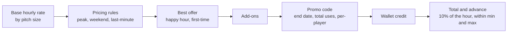

## 9. Realtime slot updates

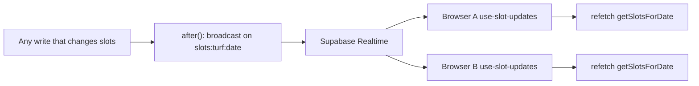

The payload is only a ping; clients refetch from the server, so no data leaks through the public channel.

## 10. Login and sessions

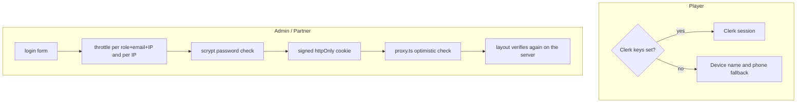

## 11. From code to production

## 12. Feature map

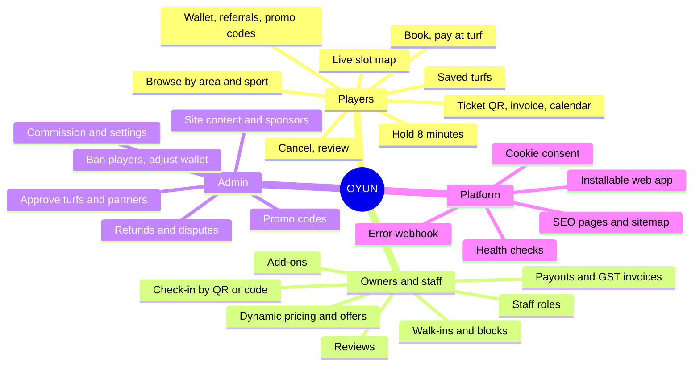

Not built yet (see `FEATURE_LIST.md` and the tracker): real payments (Razorpay), automated WhatsApp or SMS, map and filters, waitlist and recurring bookings, find players, Kannada.

## 13. Where to start reading

1. `src/app/(main)/arenas/[id]/page.tsx` and its client components: the turf page and checkout.
2. `src/lib/booking-actions.ts`: hold, quote, create, cancel.
3. `src/lib/store.ts` and `supabase/setup/3-apply-changes.sql`: how writes stay safe.
4. `src/lib/pricing.ts`: slot grid and prices.
5. `src/proxy.ts`, `src/lib/session.ts`, `src/lib/partner-auth.ts`: who may do what.
6. `e2e/` and `src/lib/*.test.ts`: the behaviour the project promises.
