# OYUN codebase map

A visual guide to how OYUN works: the pages, who uses them, how a booking flows through the code, where data lives and how changes ship. Diagrams are Mermaid, so GitHub renders them. Per-rule flowcharts (hold, price, book, cancel, check-in, refund, login and more) are in `docs/FLOWCHARTS.md`. Text docs that go deeper: `docs/ARCHITECTURE.md` (rules and limits), `docs/adr/` (why), `docs/SECURITY.md`, `docs/ENVIRONMENTS.md`, `docs/SLOT-BOOKING-DB.md` (target database).

OYUN is a multi-sport turf and court booking site for Mangalore (football, box cricket, badminton, pickleball). One Next.js 16 app serves the website and the backend; there is no separate API server or mobile app.

## 1. The system at a glance

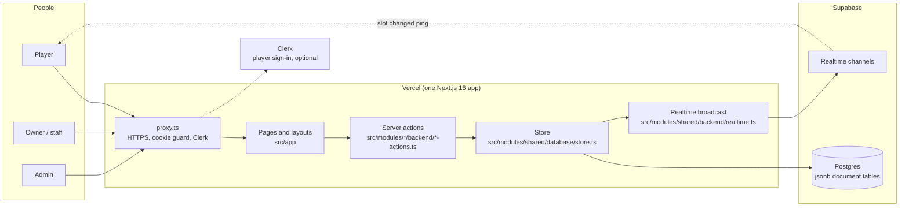

Key points:

- The browser never talks to the database. Everything goes through server actions that use the service-role key.
- Clerk is optional. Without keys, players use a device name-and-phone fallback.
- Admin and partner use signed cookie sessions (not Clerk).

## 2. Site map: every page and who it is for

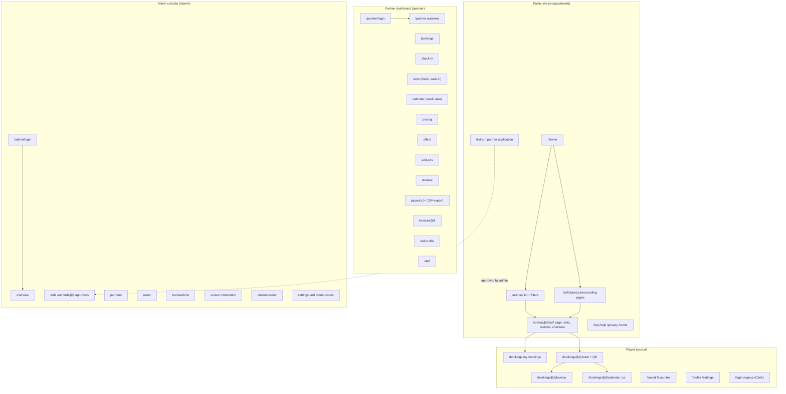

API routes (not pages): `/api/health` (launch checks and storage mode), `/api/holds/release` (release holds when a tab closes), `/api/client-error` (browser errors to the error webhook).

## 3. Who can do what

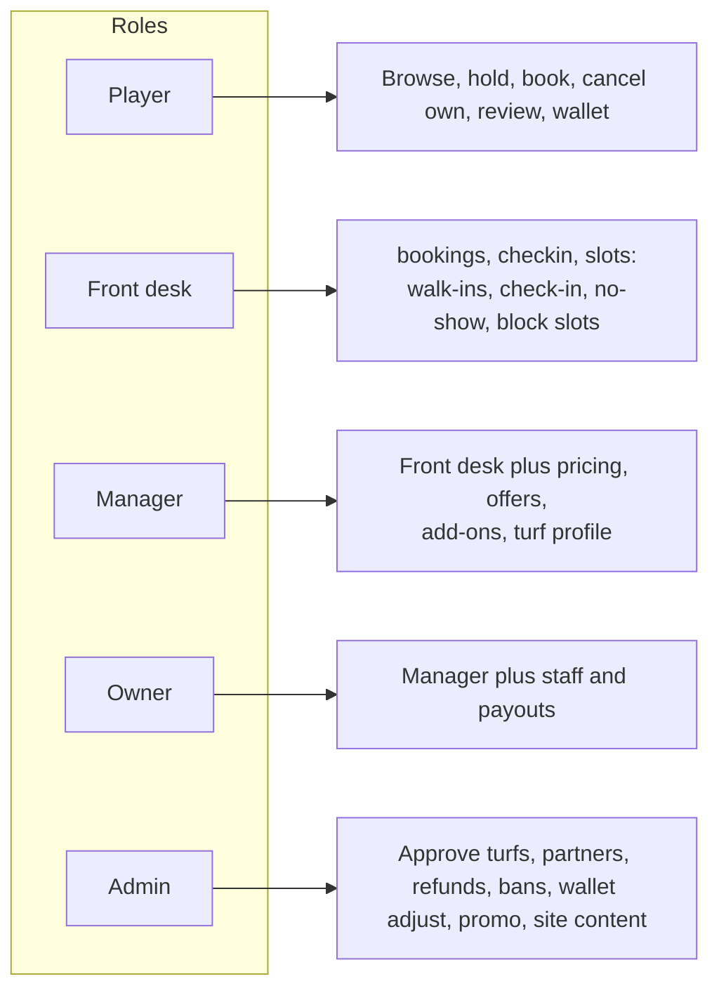

Rule in code: every admin action calls `requireAdmin()` and every partner action calls `requirePartnerAction(permission)` before touching data. `src/test/cross-cutting/authorization.test.ts` fails if an action lacks its guard. Permission sets (`PERMISSIONS` in `src/modules/shared/backend/partner-auth.ts`): front desk = bookings, checkin, slots; manager adds pricing, offers, addons, turf; owner adds staff and payouts.

## 4. How a booking works (end to end)

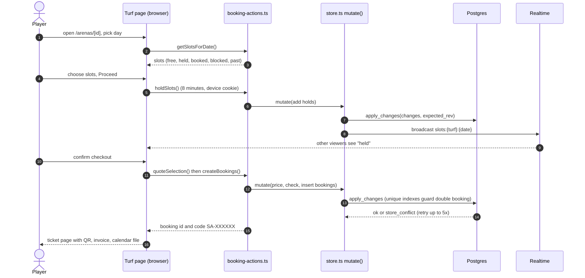

Why it cannot double book: `apply_changes` only writes if the global revision still equals what the server loaded (otherwise `store_conflict` and retry), and partial unique indexes on bookings, blocks and holds reject a second live row for the same turf, date and hour. `scripts/sql-race-test.sh` proves this in CI.

### Booking states

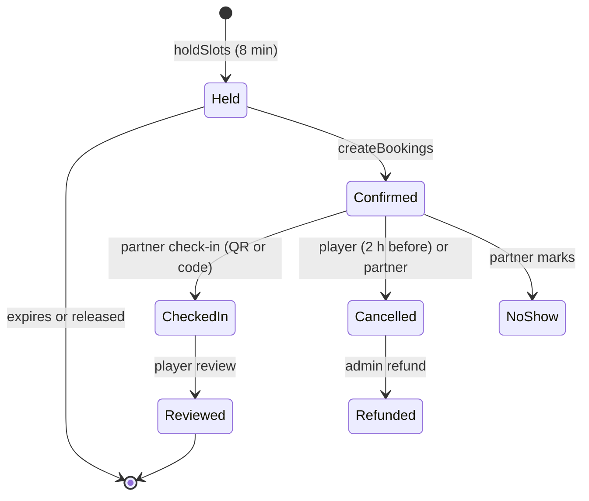

Only `confirmed` and `checked_in` occupy a slot. A multi-hour booking is one booking row per hour. The advance is recorded, not charged online; the rest is paid at the turf.

## 5. Inside a write: the store

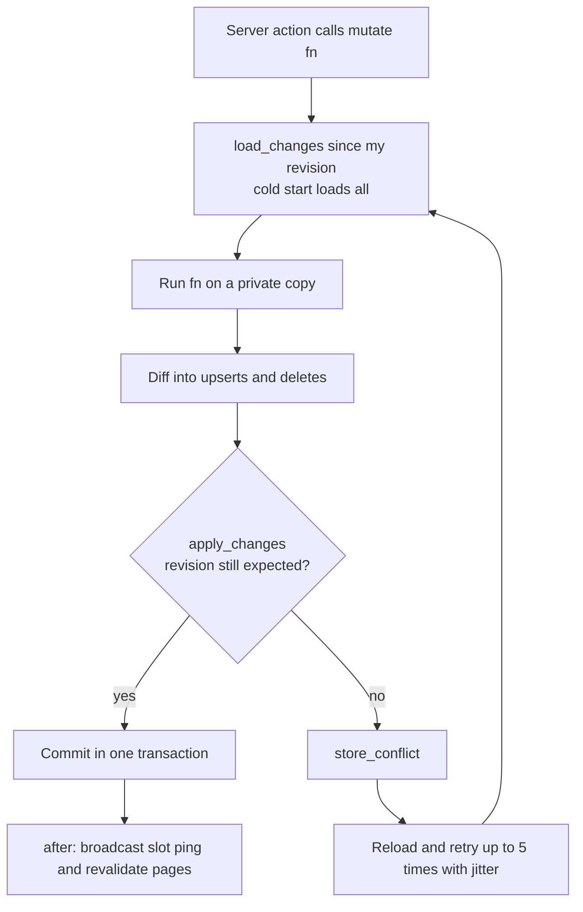

## 6. Data model

All data lives in 14 jsonb document tables (`id`, `seq`, `data`, `updated_at`) in `supabase/setup/1-tables.sql`, plus `app_meta` for the revision counter. TypeScript shapes are in `src/modules/shared/database/types.ts`.

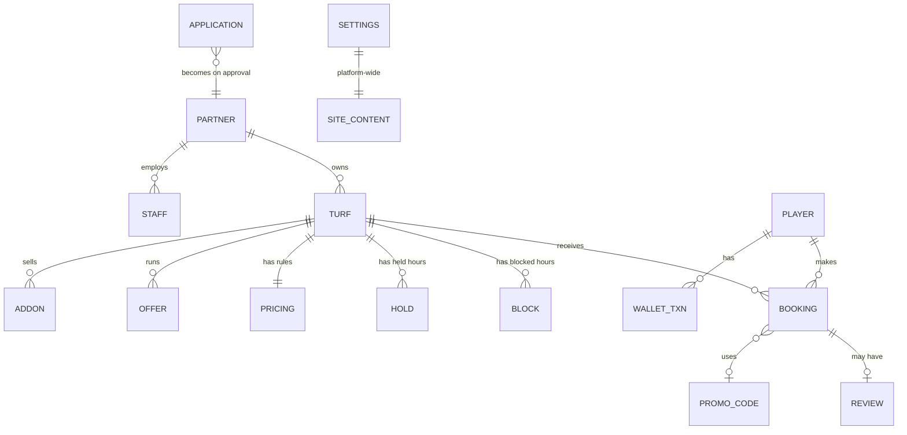

Not exact foreign keys: relationships live inside the JSON and are enforced by code, apart from the unique indexes and the CHECK constraints in `supabase/setup/7-check-constraints.sql`.

## 7. Source tree

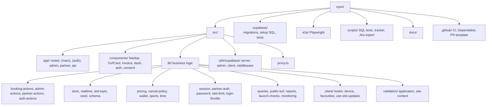

| Area | What lives there |
| --- | --- |
| `src/app/(main)` | Public and player pages |
| `src/app/partner`, `src/app/admin` | Dashboards; each has a `/login` and a `(dashboard)` group guarded in its layout |
| `src/modules/*/backend/*-actions.ts` | Server actions: the only write path |
| `src/modules/shared/database/store.ts` | `getDb()` read, `mutate(fn)` write, revision lock, delta sync |
| `src/modules/shared/lib/pricing.ts` | One function prices both the quote and the charge |
| `src/modules/shared/backend/session.ts`, `partner-auth.ts` | Signed cookie sessions, roles, permissions |
| `src/modules/web/database/public-turf.ts` | Narrow shape sent to the browser (no owner link or commission) |
| `src/modules/shared/backend/launch-checks.ts` | The checks behind `/api/health` and the admin banner |

## 8. Pricing and the checkout total

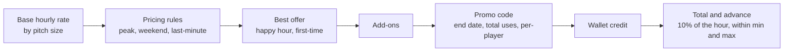

## 9. Realtime slot updates

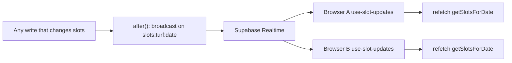

The payload is only a ping; clients refetch from the server, so no data leaks through the public channel.

## 10. Login and sessions

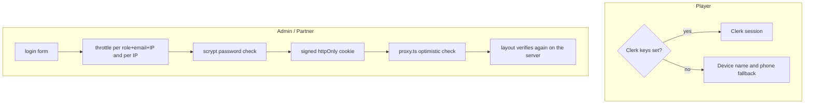

## 11. From code to production

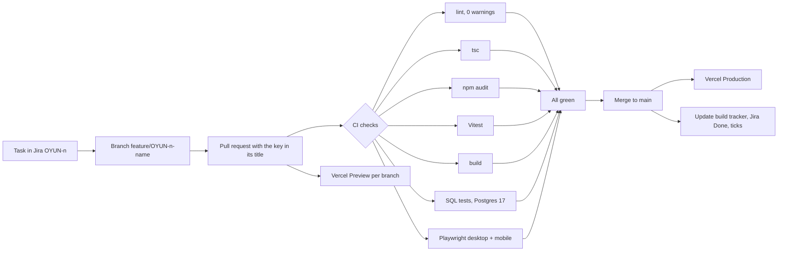

## 12. Feature map

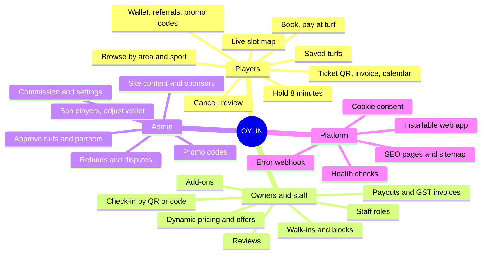

Not built yet (see `docs/FEATURE-LIST.md` and the tracker): real payments (Razorpay), automated WhatsApp or SMS, map and filters, waitlist and recurring bookings, find players, Kannada.

## 13. Where to start reading

1. `src/app/(main)/arenas/[id]/page.tsx` and its client components: the turf page and checkout.
2. `src/modules/web/backend/booking-actions.ts`: hold, quote, create, cancel (the server-side booking planner lives in `booking-plan.ts`; request/quote types, `MAX_SLOTS` and request cleaning in client-safe `booking-types.ts`).
3. `src/modules/shared/database/store.ts` and `supabase/setup/3-apply-changes.sql`: how writes stay safe.
4. `src/modules/shared/lib/pricing.ts`: slot grid and prices.
5. `src/proxy.ts`, `src/modules/shared/backend/session.ts`, `src/modules/shared/backend/partner-auth.ts`: who may do what.
6. `e2e/` and `src/modules/**/*.test.ts`: the behaviour the project promises.

## 14. Roadmap

Source of truth for order and gates: `docs/TASK-WORKFLOW.md`. Task ids (P9-05, R011 and so on) are in `docs/build-tracker.html` and Jira (project OYUN, find by `[id]` in the summary). Status is as of 10 Oct 2026.

### 14.1 The path to launch

### 14.2 Roadmap by area

| Area | Done | Next | Needs the owner first |
| --- | --- | --- | --- |
| **A. Safe and real** | Git history checked for leaked keys | Local and Vercel data parity (P8-00c) | Set `SUPABASE_SECRET_KEY` locally; rotate any key found |
| **B. Foundations** | Next 16 notes, typecheck and hook, Dependabot and `npm audit`, race test, authorization sweep, Playwright flows | Hold-expiry test (P8-05), persistent rate limits (R011 / P9-06) | Staging: Vercel and Supabase branch setup (P8-12) |
| **C. Security** | Hard-coded credentials removed, `server-only`, wallet refund on cancel, DTOs, lockout per email and IP, promo limits, image URL validation, CHECK constraints (file ready) | Anonymous ticket actions (P9-05), wallet bound to Clerk account (P9-03), cash-collected check-in (P9-11), CSP nonces (P9-13), unused Supabase proxy step (P9-16) | Rotate old Supabase key and admin and partner passwords (P9-01); run `7-check-constraints.sql` on production; choose admin MFA: TOTP or Clerk (P9-09) |
| **D. Database v2** | Design in `docs/SLOT-BOOKING-DB.md` and `supabase/proposals/` | Migration and RPC wrappers, venue to resources mapping, multi-court venues (R007), any slot length (R009), one order per checkout (R010), retire jsonb for bookings (R008), per-turf version (P10-02) | Approve production runs: pg_cron hold expiry (P10-06), deleting old tables |
| **E. Payments** | Advance is recorded, nothing charged online | Razorpay order and signature (P11-01), idempotent webhook (P11-02), advance mode (P11-03), gateway refunds (P11-04), payment-state tests (P11-06), wallet ledger (R013), payouts and GST invoices, reconciliation (P11-05) | Razorpay account and test keys |
| **F. Performance and UX** | `loading.tsx` and skeletons | Page caching with tags (P10-03), Realtime plus on-focus refetch instead of 10 s poll (P10-04), k6 load test (P10-08) | Supabase Storage for image optimisation (P10-09) |
| **G. Features** | Multi-sport, favourites, calendar and WhatsApp share, owner offers, staff roles, reviews, partner week calendar | Search filters (P13-04), waitlist and recurring weekly (P13-06), split payment link, find players (P13-01), tournaments (P13-02), weather alerts (P13-03), admin analytics (P13-05), Kannada (P13-07) | Choose WhatsApp or SMS provider (P12-01 to P12-05); choose Google Maps or Mapbox |
| **H. Quality and launch** | `docs/SECURITY.md`, architecture and ADRs | CI concurrency test, accessibility (axe), Lighthouse 90, bad-path tests, DPDP export and delete, SEO landing pages, monitoring (double bookings must be 0), runbooks | Backup restore runbook needs the Supabase plan and a tested restore; uptime service choice |

### 14.3 Roadmap by feature (who gets what)

```mermaid
flowchart TD
  subgraph Players
    P1["Now: browse, hold, book, ticket, cancel, review, wallet, promo, saved"]
    P2["Next: wallet tied to account, book again, reschedule"]
    P3["Later: waitlist, recurring, split payment, find players, tournaments, weather, Kannada"]
    P1 --> P2 --> P3
  end
  subgraph Owners
    O1["Now: check-in, walk-ins, blocks, pricing, offers, add-ons, staff, payouts CSV, invoices"]
    O2["Next: owner alerts, real payouts"]
    O3["Later: real payouts and reconciliation, owner alerts by WhatsApp or SMS"]
    O1 --> O2 --> O3
  end
  subgraph Admin
    A1["Now: approve turfs, refunds, commission, promo, site content, moderation"]
    A2["Next: per-user accounts, MFA, session revocation, audit log"]
    A3["Later: analytics by area, hour and conversion"]
    A1 --> A2 --> A3
  end
  subgraph Platform
    L1["Now: CI, health checks, headers, race test, Playwright"]
    L2["Next: persistent rate limits, staging, CSP nonces, caching, Realtime"]
    L3["Later: database v2, Razorpay, monitoring and backups, SEO pages, DPDP tools"]
    L1 --> L2 --> L3
  end
```

### 14.4 Gates that stop the queue

| Gate | Blocks | Owner action |
| --- | --- | --- |
| Production key and password rotation | P9-01, safe launch | Set new values in Vercel, redeploy |
| Production SQL not yet run | CHECK constraints (OYUN-232 / P9-21) | Run `supabase/setup/7-check-constraints.sql` in the Supabase SQL editor |
| Preview has no database | Ticket page on preview and git-main deployments | Add Preview Supabase and auth variables in Vercel |
| Razorpay | All of E | Open account, give test keys |
| Notification provider | P12-01 to P12-05 | Choose WhatsApp or SMS |
| Map provider | P13-04 | Choose Google Maps or Mapbox |
| Admin MFA design | P9-09 | Choose TOTP or Clerk |
| Staging | P8-12 | Vercel and Supabase branch setup |

The loop that works the queue: `/next-task` picks the first open non-gated task, branches, builds, tests, opens a PR; merges happen only when every CI check is green.
