# OYUN flowcharts

One flowchart per rule or process, each drawn from the code it names. Companion to `docs/CODEBASE-MAP.md` (the big picture, site map, data model and roadmap). Mermaid, so GitHub renders them.

Contents: 1 slot status, 2 hold, 3 price, 4 create booking, 5 cancel, 6 check-in, 7 no-show, 8 admin refund, 9 wallet and rewards, 10 turf application and approval, 11 admin and partner login, 12 route guard, 13 action error handling, 14 is booking open, 15 pull request to release.

## 1. What status does a slot show?

`getSlots` in `src/lib/pricing.ts`. Order matters: the first rule that matches wins.

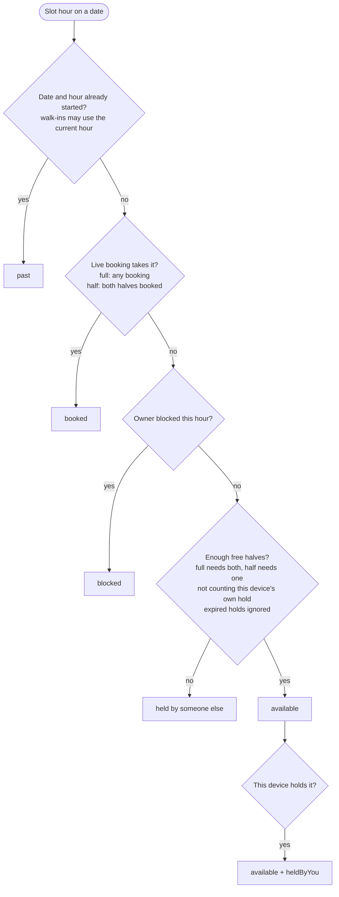

Booking statuses that count as taken: confirmed, checked_in, no_show. Cancelled and refunded free the slot.

## 2. Hold a slot (`holdSlots`)

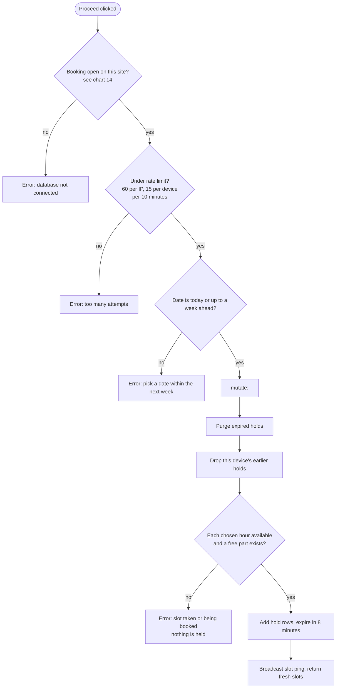

A hold lasts 8 minutes (`HOLD_MINUTES`). Leaving the checkout or closing the tab calls `releaseHolds` (`/api/holds/release` for the tab-close beacon).

## 3. How the price is built (`buildQuote`)

The same function builds the quote and the charge.

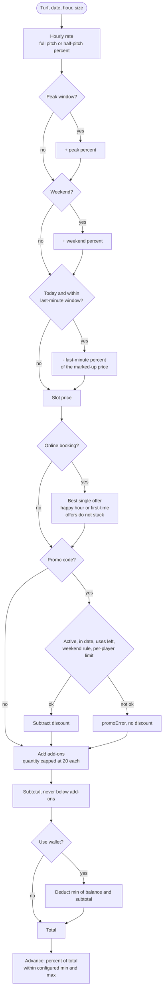

Walk-in bookings skip offers and the first-time check.

## 4. Create a booking (`createBookings` and `planBooking`)

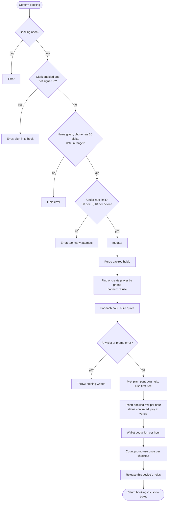

If two people reach `apply_changes` together, only one wins: the revision lock raises `store_conflict` for the other, which reloads and finds the slot gone. The unique index is the last backstop.

## 5. Player cancels (`cancelMyBooking`)

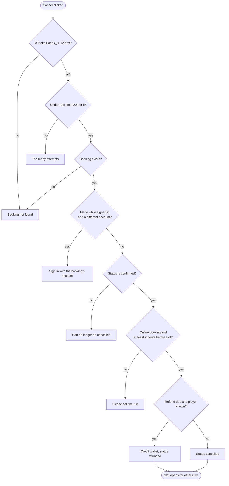

`refundDue`: wallet credit used at booking plus any amount really paid in. An "advance" amount that was only recorded is not refunded because nothing was charged.

## 6. Partner checks a player in (`checkInBooking`)

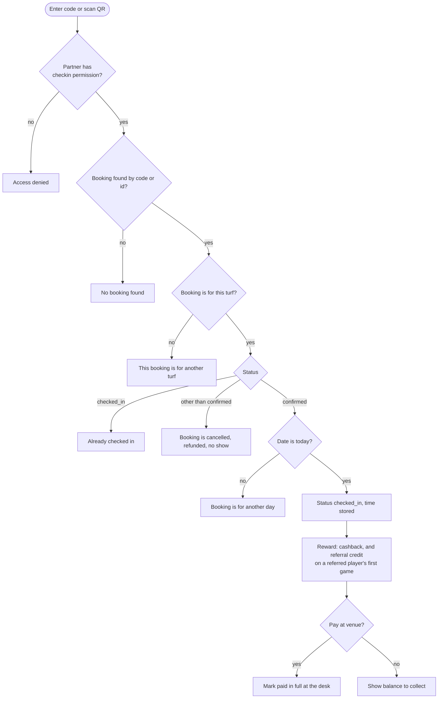

## 7. No-show (`markNoShow`)

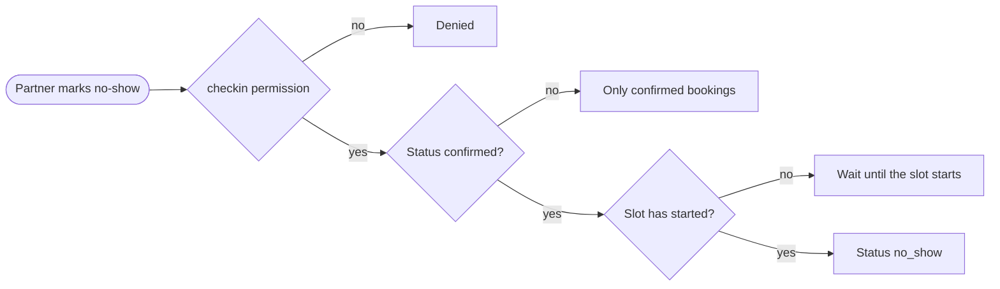

## 8. Admin refund (`refundBooking`)

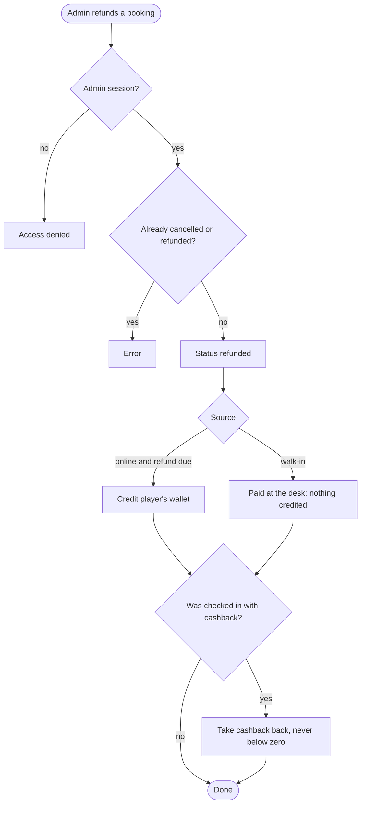

## 9. Wallet and rewards

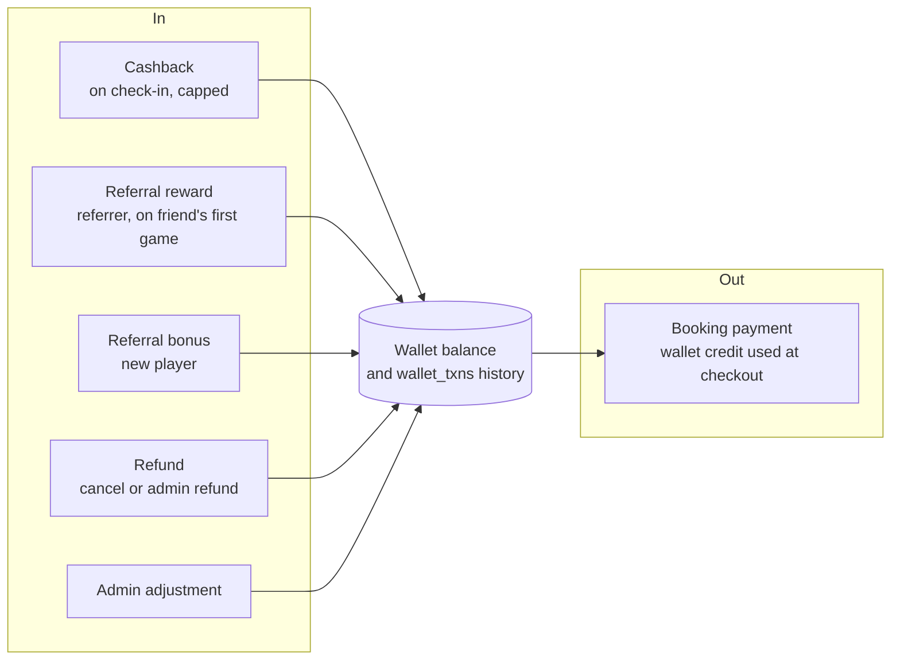

Every change goes through `walletTxn`, so the history always sums to the balance.

## 10. A turf joins OYUN

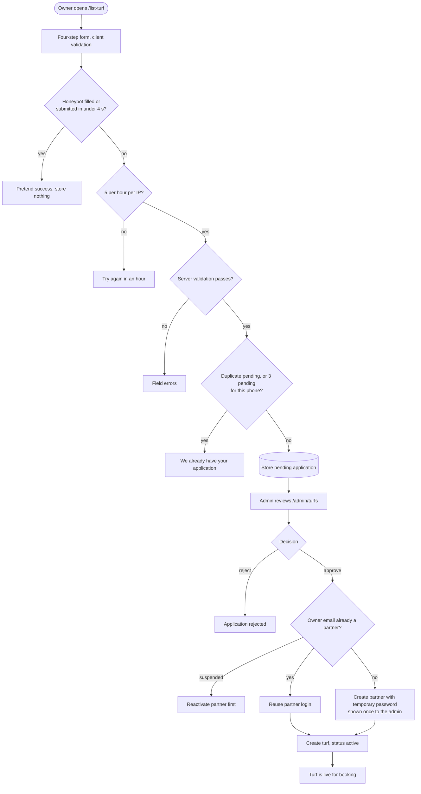

## 11. Admin and partner login (`login`)

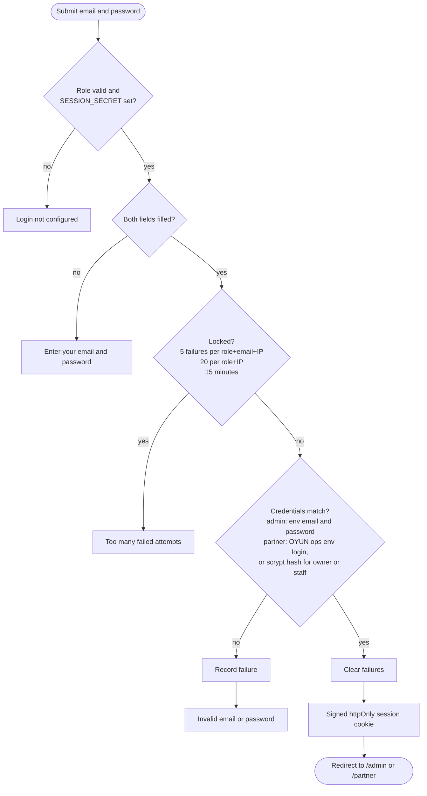

## 12. Who may open a dashboard page?

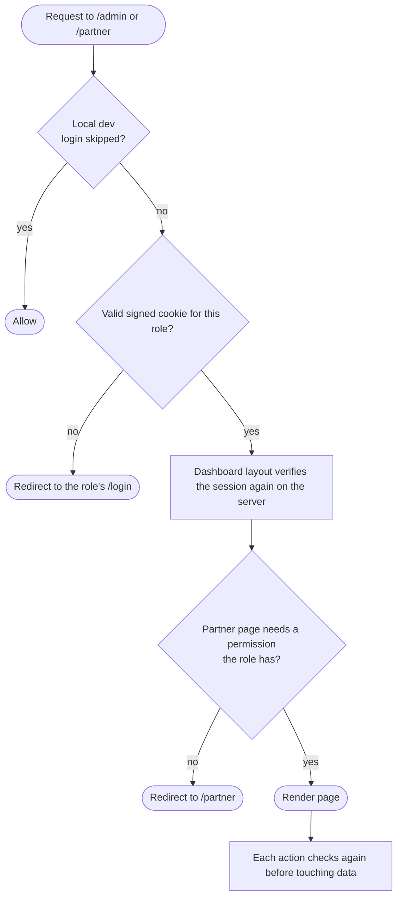

The proxy check is optimistic (cookie only); the layout and every action are the real guard.

## 13. How action errors reach the screen

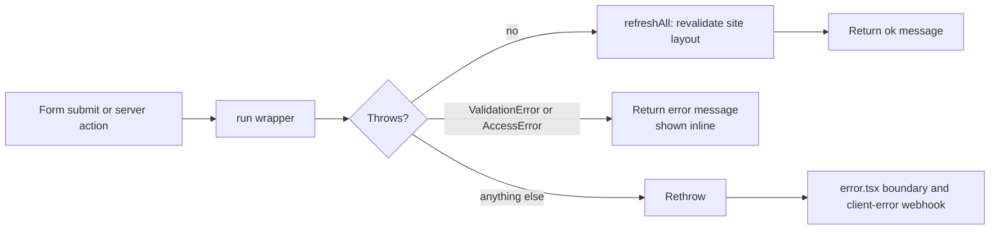

## 14. Is booking open on this site?

`booking-availability.ts`, enforced in `holdSlots` and `createBookings`.

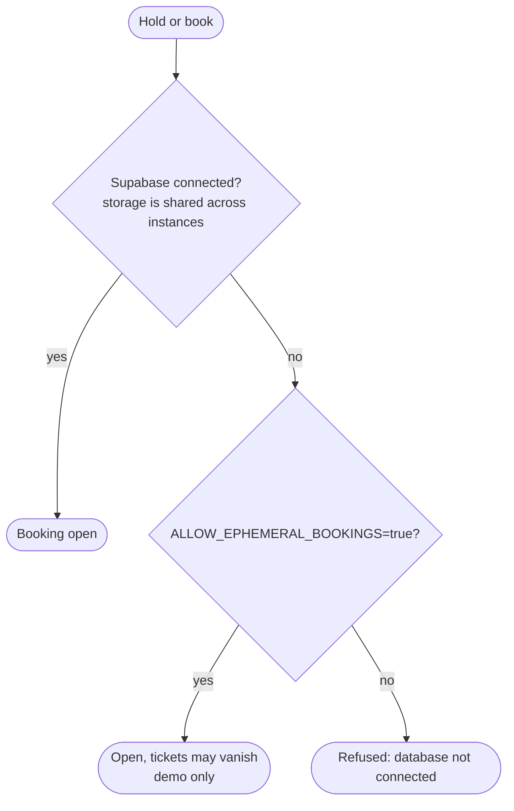

`/api/health` and the admin banner report the same state (`launch-checks.ts`).

## 15. From a pull request to release

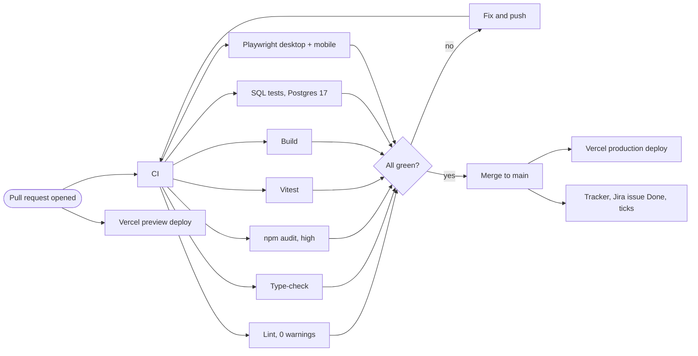

Database changes ship separately: idempotent SQL in `supabase/migrations/`, tested with `npm run test:sql`, then run by the owner in the Supabase SQL editor.
