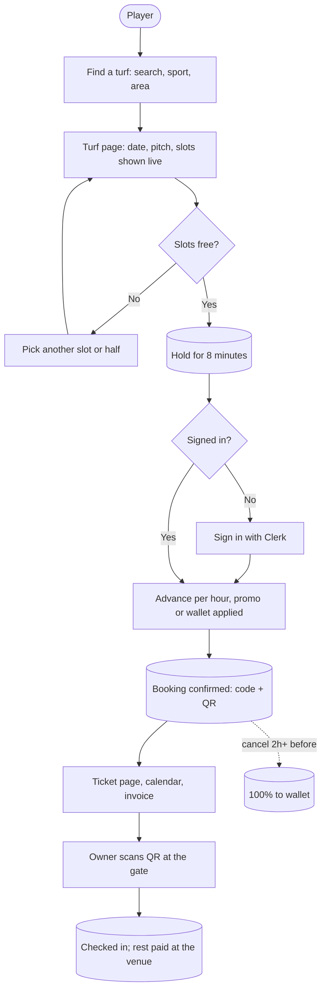
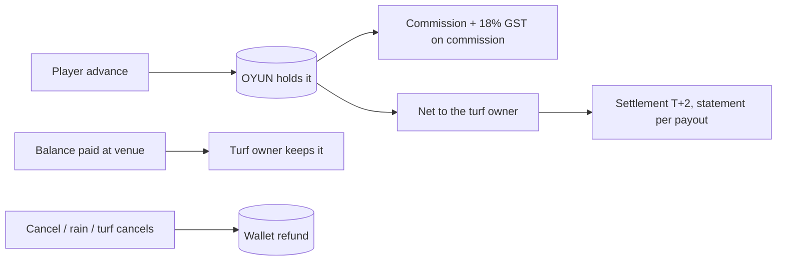
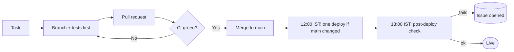

# Phase Tracker

Live record of every phase: what it contains, how it flows, and exactly where it stands. **This file is updated as work happens**: no phase item is marked done until its gates pass. The item-by-item source of truth is [build-tracker.html](build-tracker.html); this page is the readable map of it (first generated from the tracker on 17 October 2026, kept by hand from here: when an item changes, change it in both places), and [FEATURE-WORKFLOW.md](FEATURE-WORKFLOW.md) is the 18-step process every item follows.

| Legend | Meaning |
| ------ | ------- |
| ⬜ | not started |
| 🟡 | in progress: some items open |
| ✅ | done: gates passed |
| ⛔ | blocked: see the blocker note |

Priorities on open items run from **P0** (highest) to **P3** (lowest), as in the tracker.

---

## Phase index

Every phase at a glance. Detail, open items and done items for each are further down.

| ID | Phase | Covers | When | Status | Depends on | Open items |
| -- | ----- | ------ | ---- | ------ | ---------- | ---------- |
| P0 | Bootstrap | Scaffold the OYUN site with real turf cards and multi-slot booking. | 5 Oct | ✅ | — | — |
| P1 | Prototype detour | Try standalone HTML prototypes for the PWA and owner dashboard. | 6 Oct | ✅ | P0 | — |
| P2 | Hardening and data | Fix Vercel-breaking bugs, move storage to Supabase, add holds. | 6 Oct | ✅ | P1 | — |
| P3 | SEO, compliance, readiness | Be findable, legal and monitored before any traffic. | 6 Oct | ✅ | P2 | — |
| P4 | Mobile UI iteration | Make the phone experience feel like an app. | 6 Oct | ✅ | P2 | — |
| P5 | Player sign-in (Clerk) | Real accounts for players, required before paying. | 6 Oct | ✅ | P2 | — |
| P6 | Launch-ready | Remove demo data and ship a real pay-at-venue product. | 6 Oct | ✅ | P2–P5 | — |
| P7 | Launch polish | Operational extras and engagement features. | 6 Oct | 🟡 | P6 | 1 |
| P8 | Quality foundation | Make change safe: tests, CI, typed checks, accurate docs. | next | 🟡 | P0–P7 | 8 |
| P9 | Security hardening | Close the identity, wallet and rate-limit gaps before real money. | next | 🟡 | P8 | 4 |
| P10 | Scale the store | Stop loading the whole database per request. | before traffic | 🟡 | P6 | 6 |
| P11 | Online payments | Take advance or full payment through Razorpay. | after P8 + P9 | 🟡 | P8, P9 | 1 |
| P12 | Notifications | Confirmations and reminders players and owners rely on. | after P11 | ✅ | P11 | — |
| P13 | Growth | Features that bring players back. | later | ✅ | P7 | — |

**Build order:** P0 to P7 built the product in the first week (5 to 6 October). P8 (quality) and P9 (security) come before real money, P10 (scale) before traffic, then P11 (online payments), P12 (notifications) and P13 (growth).

### Progress

| Phase | Done | In progress | Not started | Blocked | Total |
| ----- | ---- | ----------- | ----------- | ------- | ----- |
| P0 Bootstrap | 4 | 0 | 0 | 0 | 4 |
| P1 Prototype detour | 2 | 0 | 0 | 0 | 2 |
| P2 Hardening and data | 6 | 0 | 0 | 0 | 6 |
| P3 SEO, compliance, readiness | 7 | 0 | 0 | 0 | 7 |
| P4 Mobile UI iteration | 4 | 0 | 0 | 0 | 4 |
| P5 Player sign-in (Clerk) | 4 | 0 | 0 | 0 | 4 |
| P6 Launch-ready | 5 | 0 | 0 | 0 | 5 |
| P7 Launch polish | 46 | 0 | 1 | 0 | 47 |
| P8 Quality foundation | 73 | 1 | 7 | 0 | 81 |
| P9 Security hardening | 30 | 0 | 4 | 0 | 34 |
| P10 Scale the store | 17 | 0 | 5 | 1 | 23 |
| P11 Online payments | 10 | 0 | 1 | 0 | 11 |
| P12 Notifications | 5 | 0 | 0 | 0 | 5 |
| P13 Growth | 15 | 0 | 0 | 0 | 15 |
| **All phases** | **228** | **1** | **18** | **1** | **248** |

---

## Position as of 17 October 2026

**The product is built and live.** Players can find a turf, hold slots for 8 minutes, book with a pay-at-venue advance, get a ticket with a QR code, and cancel. Turf owners have their own dashboard (slots, calendar, bookings, check-in, pricing, offers, payouts, analytics) and the admin runs the platform. Public pages are served from the CDN in about 0.1 s; slot lists are fetched live in the browser. What still stands between this and a public launch on **31 October 2026** is mostly decisions, accounts and production steps that only the owner can do (see Blockers), not code.

| Needed for launch | State |
| ----------------- | ----- |
| Booking, holds, tickets, cancellations | ✅ live |
| Owner and admin dashboards | ✅ live |
| Player sign-in (Clerk) | ✅ live; production keys and Google/Apple still to be switched on |
| CI on every pull request | ✅ lint, types, tests, build, e2e, Lighthouse, SQL, secret scan |
| Deploys | ✅ one deploy a day at 12:00 IST (see [DEPLOY-SCHEDULE.md](DEPLOY-SCHEDULE.md)) |
| Monitoring | ✅ health check, double-booking monitor, post-deploy check at 13:00 IST |
| Online payments | ⬜ pay-at-venue for now; Razorpay is P11 |
| Legal review (partner agreement, refunds, DPDP) | 🟡 draft pack ready in [legal/](legal/README.md); reviewer needed (P8-16) |
| Production SQL steps | ⬜ P9-21, P9-22, P10-13, P10-16 not yet run |
| Secrets rotated before launch | ⬜ P9-31 |
| Hosting plan decided (Vercel Pro or other) | ⬜ P8-13 |

**Defects found while building** are logged in [BUGS.md](BUGS.md).

---

## The whole picture

### Booking flow

### Money flow

### From change to live site

---

## P0 Bootstrap — ✅

**Scaffold the OYUN site with real turf cards and multi-slot booking.**

- **When:** 5 Oct
- **Depends on:** —
- **Exit gate:** Home, arena list and booking page render with seed turfs.
- **Progress:** 4 of 4 items done

4 done items

| Item | What |
| ---- | ---- |
| P0-01 | Scaffold OYUN app with eight seed turfs |
| P0-02 | Fix turf card grid height, add logo |
| P0-03 | Multi-slot booking and high-resolution logo |
| P0-04 | Popup ad and demo login buttons |

---

## P1 Prototype detour — ✅

**Try standalone HTML prototypes for the PWA and owner dashboard.**

- **When:** 6 Oct
- **Depends on:** P0
- **Exit gate:** Reverted within five minutes; React site restored.
- **Progress:** 2 of 2 items done

2 done items

| Item | What |
| ---- | ---- |
| P1-01 | HTML PWA and owner-dashboard prototypes, redirect routes to them |
| P1-02 | Revert prototype rewrites, restore React site |

---

## P2 Hardening and data — ✅

**Fix Vercel-breaking bugs, move storage to Supabase, add holds.**

- **When:** 6 Oct
- **Depends on:** P1
- **Exit gate:** Persistent store, double-booking guard, 8-minute holds, PWA shell.
- **Progress:** 6 of 6 items done

6 done items

| Item | What |
| ---- | ---- |
| P2-01 | Fix Vercel read-only reseed, camera Permissions-Policy, stale prerendered login pages |
| P2-02 | Login lockout (5 failures, 15 minutes) plus CSP and COOP headers |
| P2-03 | Supabase store: jsonb tables, load_state and apply_changes, optimistic rev lock |
| P2-04 | Partial unique index on live bookings |
| P2-05 | 8-minute holds keyed by device-cookie hash, single-transaction multi-slot booking, quote dry-run |
| P2-06 | PWA manifest and mobile app shell |

---

## P3 SEO, compliance, readiness — ✅

**Be findable, legal and monitored before any traffic.**

- **When:** 6 Oct
- **Depends on:** P2
- **Exit gate:** Sitemap, JSON-LD, consent, privacy and terms, error alerts, spam guards. PR #1.
- **Progress:** 7 of 7 items done

7 done items

| Item | What |
| ---- | ---- |
| P3-01 | SEO: metadata, sitemap, JSON-LD, area landing pages, 404 |
| P3-02 | Error monitoring: instrumentation hooks and Slack/Discord webhook |
| P3-03 | Privacy policy, terms, cookie consent gating GA4 and Vercel analytics |
| P3-04 | Spam protection (honeypot, timing, rate limit), validation, HTTPS redirect |
| P3-05 | Launch and SEO playbook docs |
| P3-06 | Local dev works with no keys (JSON file fallback) |
| P3-07 | Sport landing pages at /sports/[sport] for each city, area and sport, with structured data and sitemap entries |

---

## P4 Mobile UI iteration — ✅

**Make the phone experience feel like an app.**

- **When:** 6 Oct
- **Depends on:** P2
- **Exit gate:** Top bar, floating search, side menu, compact filters. PRs #2 to #5.
- **Progress:** 4 of 4 items done

4 done items

| Item | What |
| ---- | ---- |
| P4-01 | Back buttons return to previous page |
| P4-02 | App-style top bar, floating search, remove bottom tab bar |
| P4-03 | Side menu from top-left button |
| P4-04 | Compact filter bar, hide top bar on scroll down |

---

## P5 Player sign-in (Clerk) — ✅

**Real accounts for players, required before paying.**

- **When:** 6 Oct
- **Depends on:** P2
- **Exit gate:** Clerk sign-in and sign-up, sign-in gate at checkout. PRs #6 to #8.
- **Progress:** 4 of 4 items done

4 done items

| Item | What |
| ---- | ---- |
| P5-01 | Clerk sign-in and sign-up pages |
| P5-02 | Richer mobile home: top rated, deals, quick actions, areas |
| P5-03 | Sign in before paying, professional auth screens |
| P5-04 | Greet signed-in players by name |

---

## P6 Launch-ready — ✅

**Remove demo data and ship a real pay-at-venue product.**

- **When:** 6 Oct
- **Depends on:** P2–P5
- **Exit gate:** Real data only, live slot broadcast, idempotent migration, GO-LIVE guide. PR #9.
- **Progress:** 5 of 5 items done

5 done items

| Item | What |
| ---- | ---- |
| P6-01 | Real data only: remove demo accounts and fake content |
| P6-02 | Pay-at-venue booking mode |
| P6-03 | Live slot updates through Supabase Realtime broadcast |
| P6-04 | Idempotent migration, reset script, GO-LIVE guide |
| P6-05 | Cookie banner as full-width bottom bar |

---

## P7 Launch polish — 🟡

**Operational extras and engagement features.**

- **When:** 6 Oct
- **Depends on:** P6
- **Exit gate:** Health check, account-linked bookings, self-cancel, reviews, saved turfs. PRs #10 to #13.
- **Progress:** 46 of 47 items done, 1 open

| Item | Priority | Status | What | Note |
| ---- | -------- | ------ | ---- | ---- |
| P7-26 | P2 | ⬜ to do | OneLve Pickleball: get hourly price, opening time, phone number and real photos from the owner | Still using placeholders ₹500 and 06:00. Two courts (3 open + 2 being built) at Bejai mall. After approval, move off OYUN Operations partner to their own login. |

46 done items

| Item | What |
| ---- | ---- |
| P7-01 | Floating back button |
| P7-02 | /api/health readiness endpoint |
| P7-03 | Bookings linked to Clerk account id |
| P7-04 | Hold release beacon on page leave |
| P7-05 | Self-cancel until 2 hours before the slot |
| P7-06 | Split database setup SQL into four small files |
| P7-07 | Ratings and reviews, saved turfs, calendar and WhatsApp ticket extras |
| P7-08 | Advance payment recorded on every booking |
| P7-09 | Advance is 10% of each hour's price, never under or over ₹150 (flat ₹150 an hour by default); 3 hours asks ₹450 |
| P7-24 | Add the OneLve and TheCourtyard Pickleball venues as hidden drafts (lateTurfSeeds, added to existing databases on load) |
| P7-10 | Phone home: What do you want to play? with Football, Box Cricket, Badminton and Padel photo cards |
| P7-11 | Remove phone home area chips, quick tiles, Browse by area, Why OYUN strip; side menu Turfs by area and Help & settings |
| P7-12 | Fix the broken launch promo image and heal existing data |
| P7-13 | Fix the Padel card photo on the desktop home (dead link, black card) |
| P7-14 | Owner dashboard slide-out phone menu |
| P7-15 | Sport cards as round image icons instead of photo cards |
| P7-16 | Mobile menu keyboard navigation and input labels |
| P7-17 | Phone home: sport icons filter Open slots in place; remove How OYUN works card |
| P7-18 | Search sheet: remove area chips; home sports icon: Pickleball replaces Padel |
| P7-19 | Phone home: animate sport icons and the Open slots rail |
| P7-20 | Phone side menu: remove items, add Help center page and Settings page |
| P7-21 | Make the two Pickleball venues live: OneLve (Bejai Main Rd) and TheCourtyard (Kadri) |
| P7-22 | Decide whether the Padel Club stays a separate sport next to Pickleball on the home icons |
| P7-23 | Checkout and ticket wording: show Advance at the turf and Balance after you play; button is Confirm booking |
| P7-25 | Bottom tab bar on phones: Home, Turfs, Bookings, Profile with icons and labels |
| P7-27 | Remove side menu; move all links to Profile page (Book and Help & settings sections with subsections) |
| P7-28 | Move floating search button into the middle of the bottom tab bar as a raised red round button; sheet portaled to body |
| P7-29 | Remove Clerk UserButton pop-up from header; move account functions to Profile tab |
| P7-30 | Hide phone header account link and bookings icon; remove "Playing in Mangalore" area picker strip and List your turf pill from phone (desktop keeps both) |
| P7-31 | Add home sport filter notes: "coming soon" when a sport has no live venue (Pickleball), "every slot taken today" when all full |
| P7-32 | Phone top bar redesign: logo inset, "Book · Play · Repeat" tagline, Mangalore city chip with pulsing live dot linking /arenas, faint pitch markings |
| P7-33 | Profile tab shows signed-in player's picture (Clerk photo or initial for device sign-in), ring red when active |
| P7-34 | Turf page: New/★ badge beside name with heart on same row; opening-hours chip (and Verified, review count) above address |
| P7-35 | Remove surface chip from turf page address section (surface stays in badge above name) |
| P7-36 | Remove Why book this turf? section and leftover divider from turf page |
| P7-37 | Turf page: hours pill beside the name, round photo buttons, one heart |
| P7-38 | Turf page: View on map under the opening hours, address under the name |
| P7-39 | Turf page: sections ordered Location, About, Amenities, Player reviews |
| P7-40 | Pitch selection: book the full pitch or one half (A or B) |
| P7-41 | Booking date picker limited to one week (today + 6 days) |
| P7-42 | Admin turf form refuses to save a turf with no contact phone |
| P7-43 | Partner week calendar: every opening hour for seven days, split pitch halves shown |
| P7-44 | Partner calendar day view for one turf, with booking details |
| P7-45 | Partner calendar day view across all courts |
| P7-46 | Launching soon page: /welcome shows a live countdown to 31 Oct 2026 (IST), with a new /about page and a shared header |
| P7-47 | Service worker: caches the start files, shows push messages and handles notification clicks |

---

## P8 Quality foundation — 🟡

**Make change safe: tests, CI, typed checks, accurate docs.**

- **When:** next
- **Depends on:** P0–P7
- **Exit gate:** CI blocks merges on lint, tsc, build and tests; double-booking race test passes.
- **Progress:** 73 of 81 items done, 8 open

| Item | Priority | Status | What | Note |
| ---- | -------- | ------ | ---- | ---- |
| P8-13 | P0 | ⬜ to do | Decide commercial hosting: Vercel Pro (recommended) or a free commercial host | Vercel Hobby forbids commercial use. Pro is $20 per seat a month. |
| P8-15 | P1 | ⬜ to do | Vendor and account register; move production Supabase under the company email | Production project sits under a different email than the one used for tooling. |
| P8-16 | P1 | ⬜ to do | Partner agreement, refund and commission policy, DPDP privacy review with a lawyer or CA |  |
| P8-17 | P2 | ⬜ to do | Pick team tools: GitHub Projects or Linear, Notion, Slack or WhatsApp, Bitwarden |  |
| P8-20 | P2 | 🟡 in progress | Accessibility audit: keyboard, focus, contrast; fix findings | Automated axe checks and a keyboard booking test exist (P8-41, P8-42). Findings are not yet all fixed; no manual audit yet. |
| P8-28 | P0 | ⬜ to do | After PR #17 deploys, check Admin → Settings in production: advance 10%, minimum 150, maximum 150 (per hour) | Production keeps its saved advance percent (it may still be 30). |
| P8-75 | P2 | ⬜ to do | Home page Lighthouse performance is 60 to 80 on CI, not 90 | The CI gate floor is 0.55, so home can pass while still below the 90 goal in P8-64. Local runs score 87 to 93 (P8-71). Open: find why the shared CI runner scores lower. |
| P8-80 | P0 | ⬜ to do | One real booking on a phone, checked from a second device | Still open. Related to PRE-10 on the launch checklist. Not done by any merged PR. |

73 done items

| Item | What |
| ---- | ---- |
| P8-00 | Architecture review and this tracker |
| P8-01 | Install deps and read node_modules/next/dist/docs for Next 16 conventions |
| P8-02 | Add Vitest and unit tests for pricing.ts (peak, weekend, last-minute, offers, promo, GST, commission) |
| P8-03 | Unit tests for cancel-policy.ts and IST time helpers |
| P8-04 | Integration test: N parallel createBookings for one slot yields exactly one booking |
| P8-05 | Integration test: holds expire, release and cannot block a booking forever |
| P8-06 | Authorization test sweep: every admin and partner action rejects without a session |
| P8-07 | Playwright e2e: browse, hold, book, ticket, cancel |
| P8-08 | GitHub Actions: lint, tsc --noEmit, build, tests on every PR |
| P8-09 | Add typecheck script and a pre-commit hook |
| P8-10 | Refresh FEATURE_LIST.md; delete root replace_colors.py, update_fonts.py, update_texts.py |
| P8-11 | Add Dependabot and npm audit to CI |
| P8-12 | Staging environment: Vercel preview plus Supabase branch |
| P8-14 | Write ARCHITECTURE.md, ENVIRONMENTS.md, CONTRIBUTING.md, PR template, docs/adr |
| P8-18 | Load Inter with next/font so every device matches the design |
| P8-19 | Replace hard-coded hex values (#f5a623, #cba052) with CSS variables |
| P8-21 | Nightly database backup to a free bucket via GitHub Action; test a restore |
| P8-22 | Sentry and an uptime monitor on /api/health |
| P8-23 | Run a real booking end to end in the browser (hold, book, ticket, check-in, cancel) and log what breaks |
| P8-24 | Update FAQ, Terms, the home Pay at the Turf card, BookingFlow comments, FEATURE_LIST and GO-LIVE for the advance flow |
| P8-25 | Replace the fake home stats banner and brand ad strip; fill the footer social links |
| P8-26 | Fix the owner dashboard quick slot blocker: only 6 to 8 PM, and it ignores errors |
| P8-27 | Apply evening and weekend rates from a turf application to the approved turf's pricing |
| P8-29 | Fix checkout crash on a dev server that predates a new setting |
| P8-30 | Link the FAQ again somewhere on the phone (side menu or home) and keep a phone route to Privacy, Terms and Cookie settings |
| P8-31 | Check every hard-coded image link (sports, promos, turfs) for 404s and move them to our own files or storage |
| P8-32 | Make the local dev server re-read settings and data on code change, or warn when it is stale |
| P8-33 | Build tracker updater agent and check-tracker.mjs script |
| P8-34 | Local dev: skip admin and partner login without losing production login |
| P8-35 | Rename slot-arena to oyun-arena |
| P8-36 | Admin and partner dashboard bug fixes: refunds, walk-ins, approvals, slot blocker |
| P8-37 | Forms clear typed values after validation error |
| P8-38 | Check-in time window and turf hours limits |
| P8-39 | Admin and partner list pagination |
| P8-40 | Bad-path tests through the booking actions: half versus full pitch, promos, bans, bad dates, wallet, cancel |
| P8-41 | Accessibility checks: axe on the main pages and a keyboard-only booking test |
| P8-42 | Scrollable tables reachable by keyboard; axe check fails on serious findings too |
| P8-43 | Visual codebase map: pages, roles, booking flow, data model, CI |
| P8-44 | Flowcharts for the slot, hold, price, book, cancel, check-in, refund and login rules |
| P8-45 | Jira goals are epics OYUN-233 to OYUN-239 |
| P8-46 | Fix flaky e2e: a slot booked by one player shows as booked to another |
| P8-47 | GitHub issue templates and README improvements |
| P8-48 | Dependency bump: minor-and-patch group |
| P8-49 | Remove the duplicate CSS block, the twitter-image copy and dead exports |
| P8-50 | Split BookingFlow into PitchPicker, SlotMap, CheckoutSheet and booking-format |
| P8-51 | Move the booking planner and limits out of booking-actions.ts into booking-plan.ts and booking-types.ts |
| P8-52 | Split list-turf options, form defaults and the success screen into their own files |
| P8-53 | One shared rupee and short-hour formatter in src/lib/format.ts instead of seven copies |
| P8-54 | Move checkout form state into a useCheckoutForm hook; CheckoutSheet takes 12 props instead of about 25 |
| P8-55 | Replace 14 copy-pasted scroll regions with one tableScroll props pattern; small cleanups in the welcome page and turf loading state |
| P8-56 | CI runs duplicate-code and unused-code checks (npm run dup and npm run unused) |
| P8-57 | Branch protection on main: required CI checks, no direct push (brief B-1.3) |
| P8-58 | Secret scan (gitleaks) step in CI (brief B-1.5) |
| P8-59 | Release pipeline: build once, promote artifact, staging smoke and load gate, owner approval, canary 10 percent, auto rollback, tag and changelog (brief 5.2) |
| P8-60 | One e2e test per workflow in the brief: book, onboard, cancel and refund, payout, login; failure branches included (brief B-6.1) |
| P8-61 | Alert thresholds and phone paging; double bookings must read 0 (brief B-6.4, workflow 4.6) |
| P8-62 | Runbooks: payout failed, refund failed, webhook down, double booking found (brief B-6.8) |
| P8-63 | DPDP: consent record, export my data, delete my data, retention purge; GST invoice fields (brief B-6.7) |
| P8-64 | Lighthouse CI gate: home, arenas and turf pages score 90 or more |
| P8-65 | Home page speed: phones get only the app feed, above-the-fold images load eagerly, popup ad waits for page load plus 4 s |
| P8-66 | Lighthouse fixes for home, arenas and turf pages, with per-category thresholds |
| P8-67 | Brief plan with workflow diagrams and tickets; 10 gap tasks added to the tracker |
| P8-68 | Read-only check of which database setup steps are applied (supabase/setup/check-applied.sql) |
| P8-69 | CI green again: knip findings fixed, Gitleaks job can read pull requests, main e2e suite passes |
| P8-70 | Home page images: webp only, popup ad loaded lazily, high fetch priority on the first home promo |
| P8-71 | Lighthouse mobile performance 90+ on home, arenas and turf page: Clerk and Supabase code kept out of pages that do not use them, rupee-only font, high fetch priority on the LCP image |
| P8-72 | Lighthouse CI: per-category minimums, image warm-up, Chrome start retry, full reports kept as an artifact |
| P8-73 | Lighthouse CI gate is blocking, with a performance floor of 0.55 |
| P8-74 | Page speed follow-up: inline CSS, lazy popup ad, deferred checkout, sign-in and map on the turf page |
| P8-76 | Knip findings fixed so the unused-code check passes |
| P8-77 | Release pipeline uploads the .next build artifact with hidden files included |
| P8-78 | Sport unit tests restored |
| P8-79 | Project handoff notes with status, task inventory, gates and the deferred Mumbai move |

---

## P9 Security hardening — 🟡

**Close the identity, wallet and rate-limit gaps before real money.**

- **When:** next
- **Depends on:** P8
- **Exit gate:** All Critical and High risks in the register closed or accepted in writing.
- **Progress:** 30 of 34 items done, 4 open

| Item | Priority | Status | What | Note |
| ---- | -------- | ------ | ---- | ---- |
| P9-21 | P1 | ⬜ to do | Run supabase/setup/7-check-constraints.sql on production | Adds CHECK constraints (wallet, booking amounts, turf price, promo values) as NOT VALID, so only new writes are checked. Tested on a scratch Postgres 17. After a while, validate each constraint once (commands are in the file header). |
| P9-22 | P1 | ⬜ to do | Run supabase/setup/8-rate-limits.sql on production | Creates the rate_limits table and rl_hit, rl_get and rl_clear (server only). Tested on a scratch Postgres 15. Until it runs the site keeps the per-instance limiter, nothing breaks. Safe to run again. |
| P9-31 | P0 | ⬜ to do | Rotate SESSION_SECRET, ADMIN_PASSWORD and the Supabase secret key before public launch | Rotating SESSION_SECRET logs out all admin and partner sessions. Steps are in handoff section 5 (PR #294). Values are not recorded here. |
| P9-34 | P3 | ⬜ to do | Optional: set PARTNER_EMAIL and PARTNER_PASSWORD in the deployed environment | Listed as optional in handoff section 5 (PR #294). See P9-20 for why the seed default password matters. |

30 done items

| Item | What |
| ---- | ---- |
| P9-01 | Rotate the old Supabase secret key mentioned in GO-LIVE.md and confirm it is dead |
| P9-02 | Add import 'server-only' to utils/supabase/admin.ts, store.ts, realtime.ts |
| P9-03 | Bind wallet spend and booking identity to the Clerk account, not a typed phone |
| P9-04 | Refund walletDeduction when a booking is cancelled |
| P9-05 | Ticket page: hide phone, require account or signed token for details and actions |
| P9-06 | Shared rate limiter (Redis or database) for login, holds, applications, client-error |
| P9-07 | Lockout keyed by email plus IP, so an attacker cannot lock the admin out |
| P9-08 | Promo codes: maxUses and per-player limit |
| P9-09 | Admin: MFA, per-user accounts, session revocation, password rotation |
| P9-10 | Strip passwordHash and phones from every object that can reach a client component |
| P9-11 | Check-in: require cash-collected confirmation before amountPaid is set |
| P9-12 | Validate turf image URLs: reject //host, allowlist hosts |
| P9-13 | CSP nonces to drop 'unsafe-inline' from script-src |
| P9-14 | CHECK constraints: wallet balance not negative, amounts not negative |
| P9-15 | Private Realtime channels with authorization, or accept public pings in writing |
| P9-16 | Remove the unused Supabase auth proxy step or document why it stays |
| P9-17 | Refund rules: do not credit the wallet for an advance never collected; return the wallet-paid part |
| P9-18 | Remove the hard-coded admin and partner credentials from LoginForm.tsx; set strong ADMIN_*/PARTNER_* values on the deployed site |
| P9-19 | Refunds use refundDue() to return only wallet money really paid in; the uncollected advance is no longer credited |
| P9-20 | Remove the seed fallback password for the OYUN Operations partner login and set PARTNER_EMAIL and PARTNER_PASSWORD on the deployed site |
| P9-23 | Partner tenant isolation test: owner A cannot touch owner B's records |
| P9-24 | Authorization audit table in docs/AUTHORIZATION.md, kept honest by a test |
| P9-28 | Security hardening: session expiry check, login timing, error-webhook mentions, HTTPS redirect host, hold-release Origin |
| P9-25 | Admin can ban the author of an abusive review and hide the review |
| P9-26 | Partner and staff sign-in take the same time whether or not the account is active |
| P9-27 | Cron routes only check CRON_SECRET when it is set; make the check fail closed |
| P9-29 | Privacy export and erase act on the signed-in account only, not a typed phone number |
| P9-30 | Double-booking monitor no longer returns booking ids to the public |
| P9-32 | RPC wrapper functions callable by the service role only |
| P9-33 | Oyun database functions pin their search_path (Supabase linter 0011) |

---

## P10 Scale the store — 🟡

**Stop loading the whole database per request.**

- **When:** before traffic
- **Depends on:** P6
- **Exit gate:** Delta sync live in production, per-turf versioning, scoped reads for history, per-turf versioning, cached public pages, load test at target traffic.
- **Progress:** 17 of 23 items done, 6 open

| Item | Priority | Status | What | Note |
| ---- | -------- | ------ | ---- | ---- |
| P10-13 | P0 | ⬜ to do | Run supabase/setup/5-delta-sync.sql on the production Supabase project | Until then the new code falls back to the old full load per request and logs a warning. |
| P10-14 | P2 | ⬜ to do | Keep bookings older than 90 days out of the in-memory copy (archive table, read on demand) | Keeps cold-start loads and per-write clone and diff small as history grows. |
| P10-11 | P0 | ⬜ to do | Upgrade Supabase to Pro before launch; set spend cap and usage alerts |  |
| P10-12 | P1 | ⬜ to do | 1,000-user readiness test: 3 months of seeded bookings, k6 run, p95 under 800 ms |  |
| P10-16 | P1 | ⬜ to do | Run supabase/setup/6-half-pitch.sql on production before switching any turf to halves | Until it runs the old one-booking-per-hour index makes the second half fail to book. Code is live and safe while no turf has halves on. |
| P10-21 | P1 | ⛔ blocked | Move the database from Tokyo to Mumbai (ap-south-1), next to the Vercel functions | Deferred. Blocked by the free plan limit of 2 projects; pause the Tokyo oyun project first. Steps in handoff section 5 (PR #294). DEP-09 covers the region choice. |

17 done items

| Item | What |
| ---- | ---- |
| P10-01 | Delta sync: per-server cache plus load_changes(since) instead of load_state per request |
| P10-02 | Per-turf version instead of one global rev |
| P10-03 | Cache public pages with ISR and tag revalidation; drop connection() from the public layout |
| P10-04 | Replace the 10-second slot poll with Realtime plus on-focus refetch |
| P10-05 | loading.tsx and Suspense for every data page |
| P10-06 | pg_cron job to purge expired holds |
| P10-07 | Typed columns and foreign keys for bookings, holds, wallet transactions |
| P10-08 | k6 load test of the booking path at target traffic |
| P10-09 | Optimise images: allowlist real hosts, move turf photos to Supabase Storage |
| P10-00 | Measure the store payload; update the Cost calculator |
| P10-15 | Avoid cloning and diffing the whole store on every write (row-level write helpers) |
| P10-10 | Pin Vercel functions to Singapore next to the database; verify latency |
| P10-17 | Decide Redis vs Postgres for holds, availability cache and rate limits; write an ADR with the number that would force Redis (brief B-2.3) |
| P10-18 | Run supabase/setup/9-slot-booking-v2.sql on production |
| P10-19 | Map turfs to venues, resources and bookables (relational model), with a partner courts screen |
| P10-20 | Run supabase/setup/10-map-turfs-to-venues.sql on production |
| P10-22 | Production database moved to the new Supabase project in Tokyo (ap-northeast-1); old project deleted |

---

## P11 Online payments — 🟡

**Take advance or full payment through Razorpay.**

- **When:** after P8 + P9
- **Depends on:** P8, P9
- **Exit gate:** Signature-verified orders, idempotent webhooks, refunds and payout reconciliation.
- **Progress:** 10 of 11 items done, 1 open

| Item | Priority | Status | What | Note |
| ---- | -------- | ------ | ---- | ---- |
| P11-07 | P0 | ⬜ to do | When Razorpay is added, collect the per-hour advance through Razorpay | The advance is paid at the turf for now, so this is the step that makes it an online payment. |

10 done items

| Item | What |
| ---- | ---- |
| P11-01 | Razorpay order creation and server-side signature verification |
| P11-02 | Idempotent payment webhook with replay protection |
| P11-03 | Advance payment mode (advancePercent already computed) |
| P11-04 | Gateway refunds tied to the cancel and refund flows |
| P11-05 | Payout and commission reconciliation against gateway settlements |
| P11-06 | Tests for every payment state: paid, failed, duplicate webhook, refund |
| P11-08 | Bank payouts via a payouts API, T+2 settlement batch job, PDF statement by email; failed payout holds the amount and routes to support (brief 4.4) |
| P11-09 | Automatic refund of the second payment when two payments race for one slot (brief 4.1 failure branch) |
| P11-10 | Schedule the payout settlement and retention purge cron jobs |
| P11-11 | Split the team payment: a booking's share link and per-player amounts (UPI link and WhatsApp share) |

---

## P12 Notifications — ✅

**Confirmations and reminders players and owners rely on.**

- **When:** after P11
- **Depends on:** P11
- **Exit gate:** WhatsApp or SMS confirmation, 2-hour reminder, owner alert, email receipt.
- **Progress:** 5 of 5 items done

5 done items

| Item | What |
| ---- | ---- |
| P12-01 | Booking confirmation by WhatsApp or SMS |
| P12-02 | Reminder two hours before the slot (scheduled job) |
| P12-03 | Owner alert on new booking and cancellation |
| P12-04 | Email receipts through Resend |
| P12-05 | Service worker and web push |

---

## P13 Growth — ✅

**Features that bring players back.**

- **When:** later
- **Depends on:** P7
- **Exit gate:** Find players, tournaments, weather alerts, real map, analytics.
- **Progress:** 15 of 15 items done

15 done items

| Item | What |
| ---- | ---- |
| P13-01 | Find players and teams |
| P13-02 | Tournaments |
| P13-03 | Weather alerts for outdoor slots |
| P13-04 | Filters: price range, date, amenities; real map |
| P13-05 | Admin analytics dashboard |
| P13-06 | Waitlist and recurring bookings |
| P13-07 | Kannada interface |
| P13-08 | Photo uploads for owners (Supabase Storage) |
| P13-09 | Let players pick add-ons at checkout |
| P13-10 | Turf photo gallery carousel and a real map pin per turf |
| P13-11 | Add /welcome marketing landing page for players |
| P13-12 | Reschedule a confirmed booking to another slot |
| P13-13 | Book again from a past booking |
| P13-14 | Monsoon rain notice on open-air turfs |
| P13-15 | Wire the rain policy into cancel and refund: no cutoff and a 100% wallet refund in heavy rain |

---

## Blockers

What only the owner can unblock, taken from the open items above.

| Blocker | Blocks | Needed from |
| ------- | ------ | ----------- |
| Hosting plan: Vercel Hobby forbids commercial use (P8-13) | public launch | owner decision |
| Lawyer or CA review of agreement, refunds, DPDP (P8-16) | partner onboarding, launch | owner + reviewer |
| Run the four SQL files on production (P9-21, P9-22, P10-13, P10-16) | constraints, shared rate limits, delta sync, half pitches | owner (Supabase) |
| Rotate SESSION_SECRET, ADMIN_PASSWORD, Supabase key (P9-31) | launch | owner |
| Real owner login and details for launch turfs (P7-26 and others) | go-live of each turf | owner + turf owners |
| Razorpay account (P11-07) | online advance | owner |
| Database region move needs a free project slot (P10-21) | latency | owner (Supabase) |
| Deploy hook secret `VERCEL_DEPLOY_HOOK` | the noon deploy | owner (added) |

## Gate for launch

- [ ] Every P0 item above is done or accepted in writing
- [ ] `npm run typecheck`, `npm run lint`, `npm test`, `npm run build` pass; CI green on `main`
- [ ] One real booking on a phone, checked from a second device (P8-80)
- [ ] Production SQL steps run; secrets rotated
- [ ] Legal drafts reviewed and published; owner agreement accepted at onboarding
- [ ] Post-deploy check green for three days running
