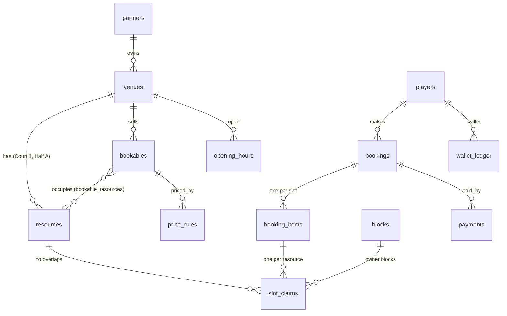

# Slot booking database (v2 proposal)

Schema: [`supabase/proposals/slot_booking_v2.sql`](../supabase/proposals/slot_booking_v2.sql) ·
Tests: [`supabase/proposals/slot_booking_v2_test.sql`](../supabase/proposals/slot_booking_v2_test.sql)

Not wired into the app yet. It lives in its own `oyun` schema, so it can be created next to today's tables
without touching them.

## Why change

Today every entity is a jsonb row, the server keeps the whole database in memory, and every write bumps one
global revision (`apply_changes(changes, expected_rev)`). That works for 10 turfs, but:

| Today | Problem | v2 |
|---|---|---|
| One global `rev` for all writes | A booking at Ullal conflicts with a review at Kodialbail; under load, writes retry each other | Row-level writes; only bookings of the same court wait for each other |
| A turf is one pitch | Smash Court has 4 badminton courts but can sell one booking per hour | Venue → resources (courts, pitch halves) → bookables |
| `hour` 0–23 | No 30-min pickleball, 90-min slots, or 00:00–01:00 slots | `tstzrange` slots, any length in 15-min steps, past midnight |
| Half pitch via two partial unique indexes | Doesn't extend to badminton/pickleball sharing a court | One exclusion constraint on resource + time |
| Multi-hour booking = separate rows | Cancel/refund/pay per order is awkward | `bookings` (the order) → `booking_items` (each slot) |
| Wallet balance stored on the player | Can drift from the transactions | Ledger is the only truth; balance is a view |
| No payments tables | — | `payments`, `payment_events` (webhook dedupe), `refunds` |

## The model



- **Resource**: a physical thing one group can use at a time: `Half A`, `Half B`, `Court 1`.
- **Bookable**: what a player picks, with its sport, slot length and base price. It occupies resources:
  - `Full pitch` → Half A + Half B
  - `Half pitch A` → Half A
  - `Badminton court 1` → Court 1
  - `Pickleball on court 1` → Court 1 (same floor, so they block each other)
- **Slot claim**: one row per resource a booking item, hold or owner block occupies.

## The one rule that stops double bookings

```sql
constraint slot_claims_no_overlap
  exclude using gist (resource_id with =, during with &&) where (released_at is null)
```

No two live claims on the same resource may overlap in time. Postgres enforces it, so no app bug, retry or race
can break it. Cancelled and expired bookings set `released_at` (a trigger does it), which frees the slot.

`hold_slots` first takes `pg_advisory_xact_lock` on each resource in a fixed order. Without it, two simultaneous
checkouts for the same court sometimes ended in a Postgres *deadlock* error instead of a clean `slot_taken`
(seen in 2 of 10 race runs). With it, every race ends with exactly one winner and `slot_taken` for the other
(14 of 14 runs).

## Booking lifecycle

```
held ──confirm_hold──▶ confirmed ──▶ checked_in ──▶ completed
  │        │                 └──▶ cancelled / no_show
  │        └─(pay online)─▶ pending_payment ──webhook──▶ confirmed
  └─ time out ─▶ expired                └─ time out ─▶ expired ─(late payment)─▶ confirmed, or refund_needed
```

| Function | Does |
|---|---|
| `hold_slots(holder, bookable, starts[])` | Validates opening hours, slot grid, past/window; prices each slot; claims resources; replaces the device's earlier hold. Raises `slot_taken`, `venue_closed`, `not_a_slot_start`, `slot_in_past`, `outside_booking_window`. |
| `confirm_hold(booking, holder, name, phone, pay_online)` | Pay-at-venue → `confirmed`. Online → `pending_payment` for 15 min. |
| `confirm_payment(order_id, payment_id, amount)` | Webhook. Idempotent. Late payment re-claims the slot if still free, else records a refund and returns `refund_needed`. |
| `cancel_booking(booking, reason)` | Frees the slots. Refund/wallet logic stays in the app (policy). |
| `block_slot(bookable, range, reason)` | Owner block; fails if already booked. |
| `available_slots(bookable, date)` | Every slot with price and state: `available`, `held`, `booked`, `blocked`, `past`. |
| `expire_holds()` | Expires timed-out holds. Runs inside `hold_slots`; also schedule with pg_cron every minute. |

Pricing: `price_rules` per bookable, applied in priority order: `set` replaces the price, `percent`/`flat`
adjust it, filtered by weekday, local time and date range. The current peak, weekend and happy-hour rules
all map to rows here. Last-minute discounts and first-time offers stay in app code (they depend on the player
and the clock), and the final price lines are snapshotted in `bookings.price_breakdown`.

## What the tests cover (all passing on Postgres 17)

Full pitch blocks both halves; two halves share an hour; halves block the full pitch; badminton 18:00–19:00
blocks pickleball 18:30 on the same court but not court 2; off-grid starts, closed hours, past slots and
beyond-window dates rejected; 00:00 slot accepted for a venue open until 01:00; expired holds free the slot;
re-hold replaces the old hold; cancel frees; owner block vs booking both ways; online payment confirm, webhook
replay no-op, late payment after someone else took the slot → `refund_needed`; peak + weekend prices
(₹1000 → ₹1200 weekend → ₹1560 weekend peak).

Run them yourself against a scratch database:

```bash
PGHOST=localhost PGPORT=5433 npm run test:sql
```

`scripts/sql-tests.sh` creates two throwaway databases on that server, applies `supabase/migrations` (twice, to prove
they re-run), then the proposal and its tests. It stops with an error if any test fails, and refuses Supabase hosts.
CI (`.github/workflows/ci.yml`) runs the same script against Postgres 17 on every pull request.

## Moving the app over

Best done **now, before launch data exists**. Production isn't on Supabase yet (`/api/health` shows
`storage: local-file`), so there is nothing to migrate.

1. Apply `slot_booking_v2.sql` to a Supabase branch or a fresh project.
2. Call the functions from the server through wrappers in `public` (simplest, since only `public` is exposed
   to the API), or add `oyun` under Project Settings → API → Exposed schemas and use
   `createClient(url, key, { db: { schema: 'oyun' } })`.
3. Replace `getDb()`/`mutate()` per feature, starting with slots: `getSlotsForDate` → `available_slots`,
   `holdSlots` → `hold_slots`, `createBookings` → `confirm_hold`, `cancelMyBooking` → `cancel_booking`,
   partner blocks → `block_slot`.
4. Map each turf to a venue with resources and bookables. A plain turf gets one resource and one bookable. A
   `halfPitch` turf gets Half A, Half B and three bookables. Badminton venues get one resource per court.
5. Realtime: keep the current broadcast topic, sent after each successful hold, booking or cancel.
6. Schedule `select oyun.expire_holds()` every minute with pg_cron.

## Open decisions

- **Slot grid**: slots start at opening time + n × slot length. Venues that want flexible starts (any half hour
  for a 60-min game) need the grid step separate from the slot length.
- **Advance**: v2 has `advance_due` and `amount_paid`. Today's rule (percent within ₹min–max) stays in app code.
- **Holidays**: add a `special_dates` table if holiday pricing is needed; weekday rules cover the rest.

## Status: v2 slots are opt-in (`OYUN_V2_SLOTS=1`)

Until the booking pages, partner dashboard, wallet, promos and payouts read from the `oyun` schema, v2 stays off.
With it off, bookings, holds, blocks and pricing are saved in the main store like every other table, and slots are
protected by the unique indexes in `supabase/migrations/20261008000000_half_pitch.sql`. With it on, those four tables
are skipped by the store, so a booking confirmed in `oyun` is invisible to the rest of the app (the ticket page 404s).
Do not run `supabase/setup/12-retire-legacy-jsonb-tables.sql` while it is off.

## Store conflicts are per row

`apply_changes` (migration `20261016000000`) rejects a write only if a row it touches changed after the revision the
caller loaded. Audit of the money paths: wallet debits/credits, referral rewards and promo use each write the row they
depend on (the player or promo row), so a race on them still conflicts and retries on fresh data. A new mutation that
reads a row it does not write must write that row too.
